<div align="center"><h1>MeBot</h1><p>A personal feed for stories, opportunities and everyday tools.</p><p>Android · English · Kiswahili · Apache 2.0</p></div>

[Latest published GitHub release](https://github.com/EmmanuelMmanda/MeBot/releases/latest) · [Installation guide](docs/download.html) · [App screens](docs/screenshots.html)

## Personal reading and story questions

For You collects sourced stories around topics you choose. Original Read is a separate, longer AI-authored piece with its Created date—not a publisher date. Optional further reading is separate from the reflection and does not verify it by itself.

Browse source-checked grants, jobs, contracts and scholarships. Publication dates and application deadlines appear separately when available. Confirm current eligibility, dates and requirements on the official listing.

With an AI provider connected, open the story’s question sheet. Choose Send to ask a question, or Edit to change the draft first. Opening the sheet alone sends nothing.

## About You and appearance

Set interests and region under About You. Review which notes each module may use, change those choices, or leave personal context empty.

Choose English or Kiswahili under You → Personalization → Language. In Appearance, select system, light or dark mode, an accent colour, and one of four page styles.

MeBot also includes Saved reading, Focus, Daily Check-in and alarms. Local tools remain available without an AI connection.

## Screens

<p align="center"><a href="docs/screenshots/v099-showcase/en-feed-for-you.png">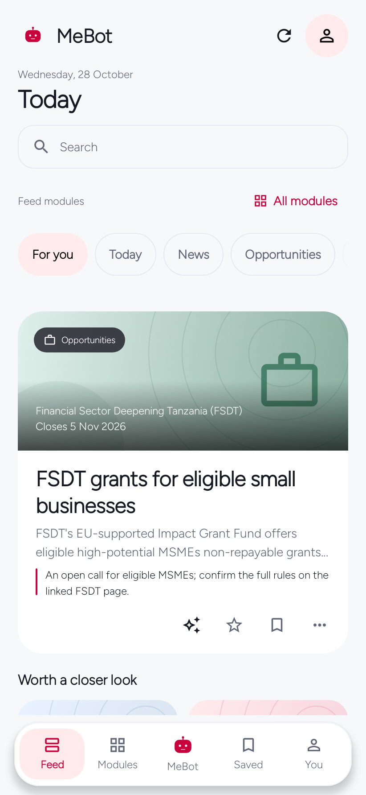</a>
<a href="docs/screenshots/v099-showcase/en-fsdt-opportunity-detail-source.png">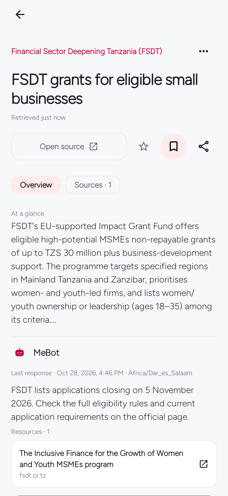</a>
<a href="docs/screenshots/v099-showcase/en-fsdt-opportunity-deadline.png">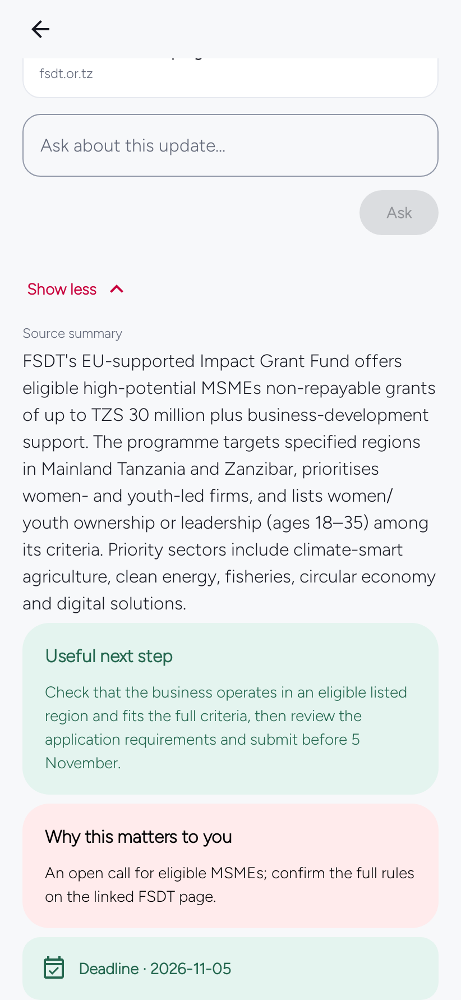</a></p>

**For You feed** · **FSDT opportunity source** · **FSDT application deadline**
<p align="center"><a href="docs/screenshots/v099-showcase/en-original-read.png">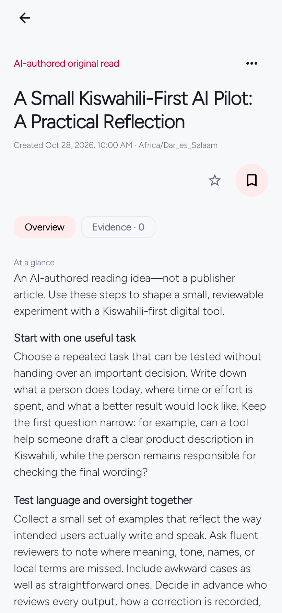</a>
<a href="docs/screenshots/v099-showcase/en-original-read-further-reading.png">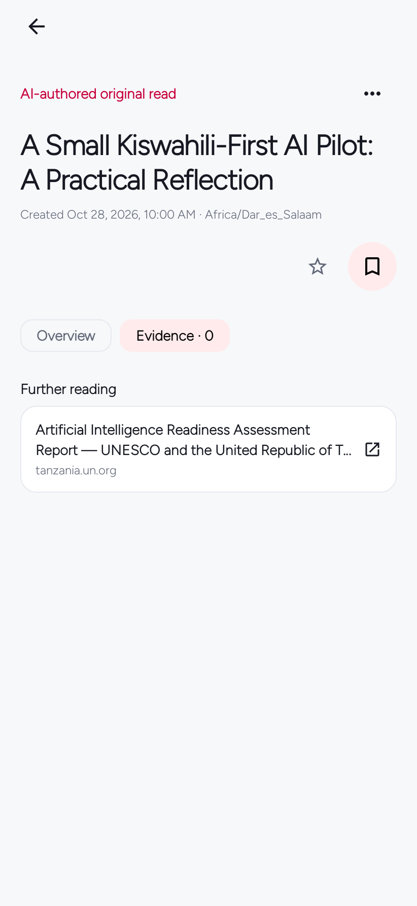</a>
<a href="docs/screenshots/v099-showcase/sw-original-read-dark-teal.png">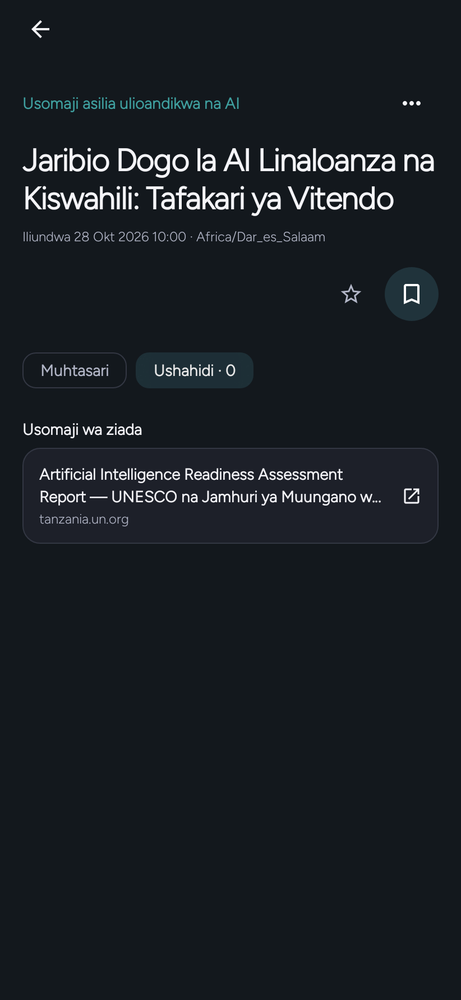</a></p>

**A reflection on Kiswahili and AI readiness** · **Further reading** · **Tafakari kuhusu Kiswahili na utayari wa AI**
<p align="center"><a href="docs/screenshots/v099-showcase/en-five-questions-top.png">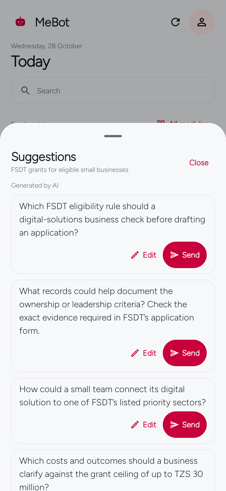</a>
<a href="docs/screenshots/v099-showcase/en-five-questions-bottom.png">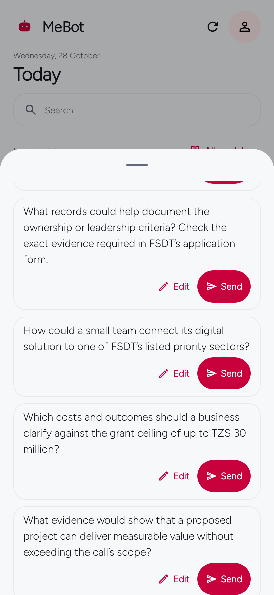</a>
<a href="docs/screenshots/v099-showcase/en-question-edit-draft.png">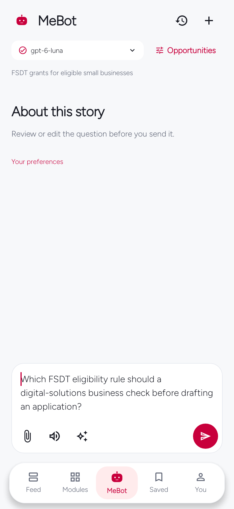</a></p>

**Five follow-up angles** · **More follow-up angles** · **Edit a suggested question**
<p align="center"><a href="docs/screenshots/v099-showcase/en-about-you.png">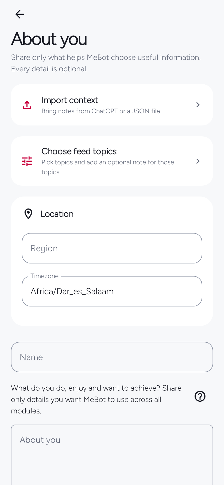</a>
<a href="docs/screenshots/v099-showcase/en-about-you-context-note.png">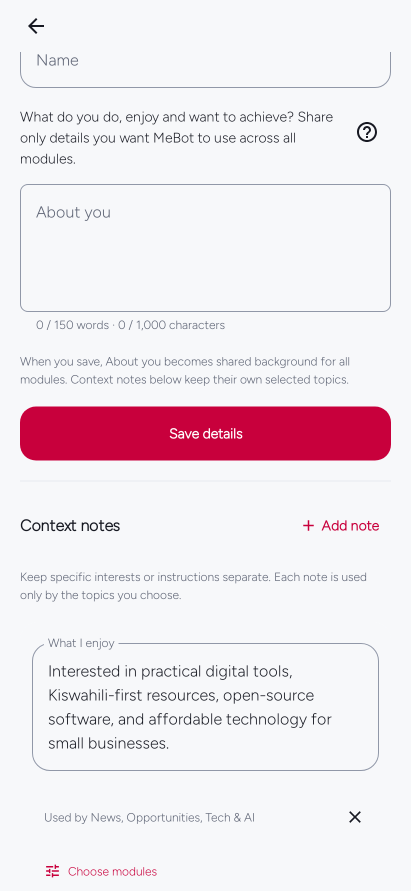</a>
<a href="docs/screenshots/v099-showcase/en-appearance-page-styles-dialog-only.png">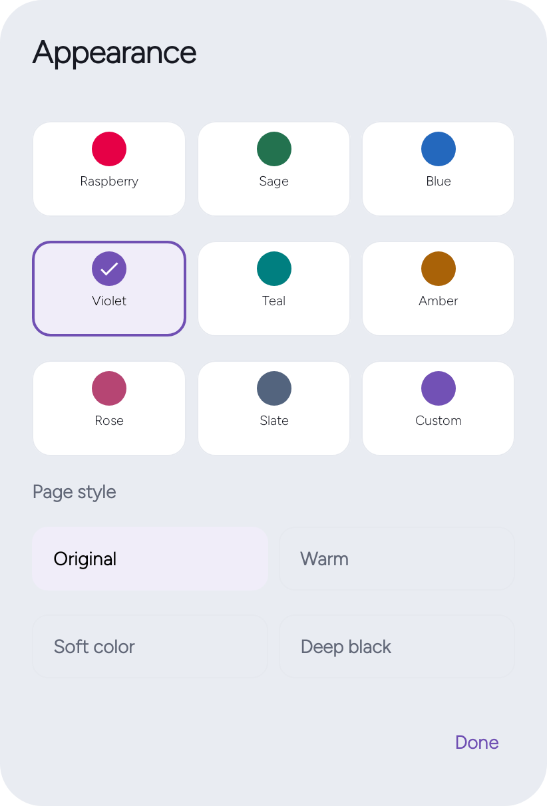</a></p>

**About You** · **About You context note** · **Appearance controls**

Screen images are examples. Any AI response shown uses sample content, not a live account result. Check linked sources for current dates and requirements. Technical capture and provenance are in the [capture record](docs/screenshots/v099-showcase/README.md).

## Install and verify

[Download page](docs/download.html) · [Latest published GitHub release](https://github.com/EmmanuelMmanda/MeBot/releases/latest) · [Start here](START-HERE.md) · [Complete user manual](docs/user-manual.html).

Install a compatible update over your existing app. Do not uninstall or clear app data as an update step. If Android reports a signing conflict, check the installation guide before changing installations.

## Choose your AI connection

| Connection | What it means |
| --- | --- |
| ChatGPT | Existing provider-authorized sign-in for eligible accounts; account/model policy applies. No access to ChatGPT memory or chats is implied. |
| OpenAI API | Explicit API key with separate API billing. |
| Claude | Anthropic API key. Claude.ai subscription credentials are not used by third-party MeBot. |
| Gemini | Gemini API key. This adapter uses the public source material supplied by MeBot; it does not claim native Google Search grounding. |
| OpenRouter | PKCE authorization with a one-time code return or API key; uses OpenRouter credits, not an imported Claude subscription. |
| Personal server | Explicit OpenAI-compatible endpoint and model. Features depend on the endpoint; a saved key is never sent over HTTP. |
| Personal service | Optional self-hosted Python service. The service currently uses its own OpenAI API adapter. |

Provider selection is explicit. No automatic switching to a separately billed provider. Model lists, completed-response checks, streaming support and source discovery follow each adapter’s capabilities. Provider credentials stay outside portable exports.

**Copy starter prompt** prepares the exact preferences JSON schema for any suitable assistant. Review imports before applying. Onboarding interests already count as personalization.

## What is included

| Area | Behavior |
| --- | --- |
| Feed | Completed modules publish immediately; new results wait behind Show new items while you read. Expired source-verified forecasts/events leave active reading; saved and starred records stay. |
| Feedback & fit | Relevant / Not relevant improves module suggestions with undo and reset. Optional bounded AI fit can help match up to eight public stories per module; it is not a probability or promise. |
| Item detail | Stable introduction, unclipped square answer surface, streaming explanations and grouped sources/media/files. |
| Activity | One fixed top panel with an anchor-width popover; real events and provider-published summaries, never invented thoughts. |
| Connection | Provider and model choice, one persisted request budget, presets/custom/unlimited and clear capability limits. |
| Background | Timing, preparation batches, Wi-Fi/battery conditions, notifications and quiet hours in actionable cards. |
| Software Updates | Automatic checks and optional Wi-Fi preparation, verified package/version/certificate/hash, and Android’s installer approval. |
| Guidance | One relevant dismissible setup notice, a short first-use tour and replay from Help. |
| Daily tools | Alarm, Focus and Daily Check-in; independent of AI. |
| Data | Clear reading history explains its scope before confirmation; saved items, conversations and relevance feedback are separate. |

## Build

JDK **17**, Gradle **8.13**, Android SDK **36**, Build Tools **35.0.0**.

```sh
git clone https://github.com/EmmanuelMmanda/MeBot.git
cd MeBot
git switch develop
python3 scripts/prepare-build.py
./gradlew :core:test :app:testDebugUnitTest :app:assembleRelease :app:lintRelease
```

Tests use controlled providers. Real account access, physical-phone media, file pickers and overnight alarms require device checks. No private profile, provider credential or signing key belongs in public source. See [Build](docs/BUILD.md), [Contributing](CONTRIBUTING.md), [Privacy](docs/PRIVACY.md), and [Security](SECURITY.md).

[Apache 2.0](LICENSE). Third-party content retains its own [notices](NOTICE) and [credits](docs/IMAGE-CREDITS.md). MeBot is independent, not endorsed by any provider or publisher.
