<div align="center">

<h1>MeBot Daily</h1><p>Your topics, source-linked answers and optional everyday tools.</p>
<p><a href="https://github.com/EmmanuelMmanda/MeBot/releases/download/v0.9.4/mebot-0.9.4.apk"><strong>Download official APK</strong></a> · <a href="https://github.com/EmmanuelMmanda/MeBot/releases/tag/v0.9.4">Release files</a> · <a href="START-HERE.md">Start here</a> · <a href="docs/USER-GUIDE.md">User guide</a></p>
<p>Android 8.0+ · English &amp; Kiswahili · Kotlin + Jetpack Compose · Apache 2.0</p></div>

> **Official MeBot 0.9.4 · 17.5 MB · `mebot.nguli.com`.** Install over the existing 0.9.x app without uninstalling or clearing data. Earlier 0.8.x binaries used a different signer and cannot receive this as an in-place update. Review the [installation guidance](docs/INSTALL.md).

Choose interests during onboarding, read a sourced feed, search, ask follow-ups and keep useful resources. Public information and local tools stay available without AI. No personal starter profile is baked into the app.

## What’s new in 0.9.4

- After confirming a context import, return to your details and see the notes you just saved. An invalid file or cancelled review leaves your draft alone.
- Expired source-verified forecasts and events leave the active feed; saved and starred items remain available, and evergreen reading gets more time.
- Optional AI can help match a short list of public stories to your confirmed interests during the existing feed refresh. Your reading position and explicit feedback stay in control.

[Full experience-first release notes](docs/RELEASE-0.9.4.md). Technical verification, source identity and test limits are in the separate [verification report](https://github.com/EmmanuelMmanda/MeBot/releases/download/v0.9.4/MeBot-0.9.4-verification.md).

## See the current app

<p align="center">
<a href="docs/screenshots/v090/onboarding-en-chooser.png"></a>
<a href="docs/screenshots/v090/onboarding-sw-chooser.png">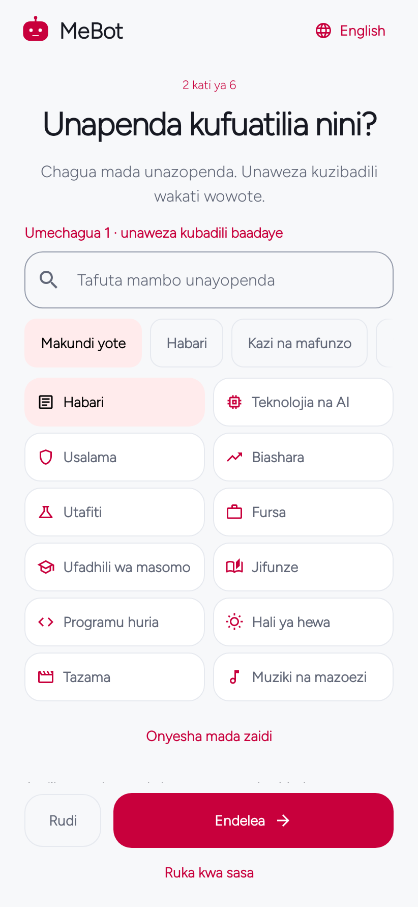</a>
<a href="docs/screenshots/v092/context-import-sw.png">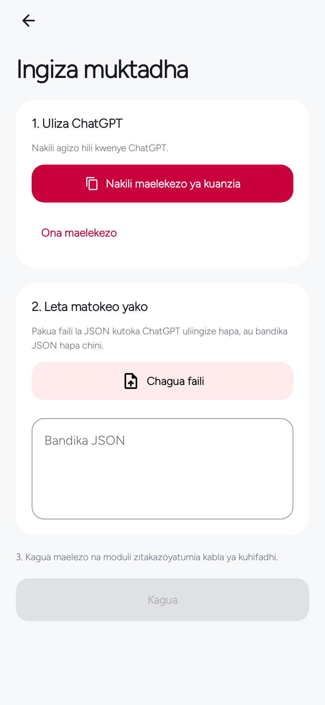</a>
</p>

**Choose your interests** · **Chagua unavyopenda** · **Bring your context**
<p align="center">
<a href="docs/screenshots/v094/imported-notes-en.png"></a>
<a href="docs/screenshots/v094/imported-notes-sw.png">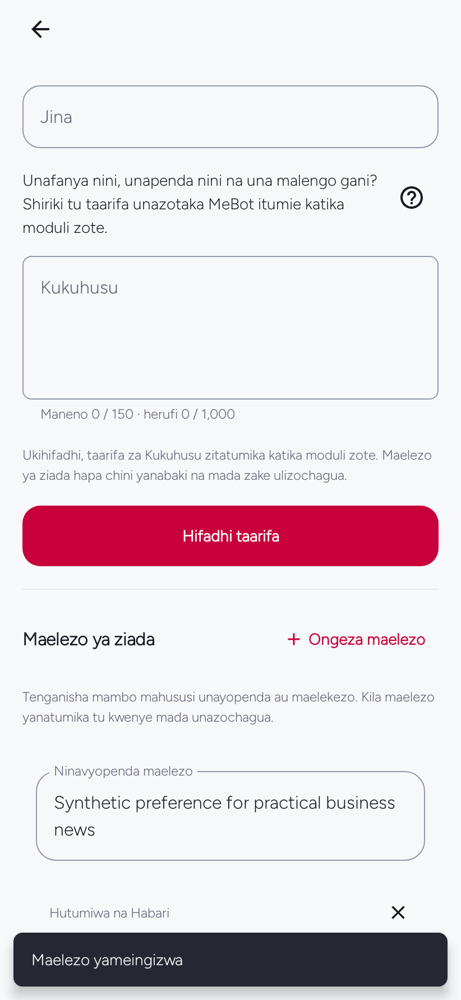</a>
<a href="docs/screenshots/v092/connection-sw.png"></a>
</p>

**Your notes are ready** · **Vidokezo vyako viko tayari** · **Your AI connection**
<p align="center">
<a href="docs/screenshots/v092/starred-sw.png">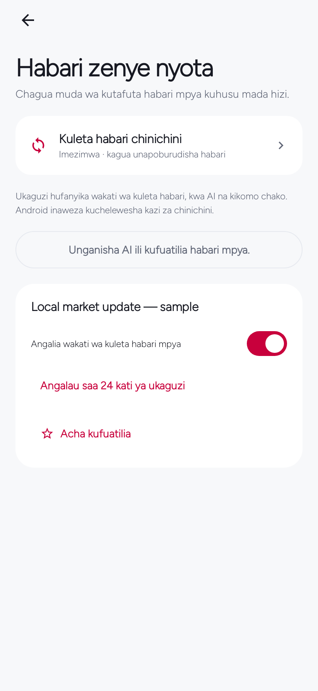</a>
<a href="docs/screenshots/v092/personalization-sw.png">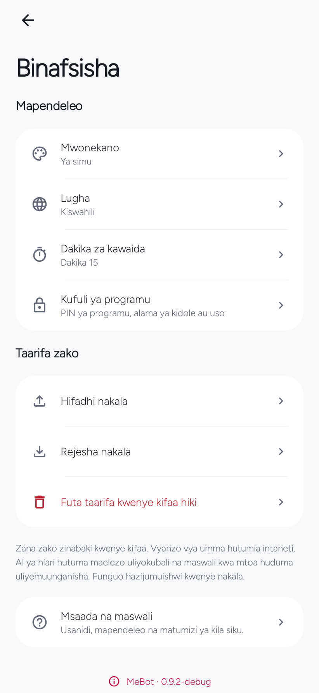</a>
<a href="docs/screenshots/v092/lock-setup-sw.png">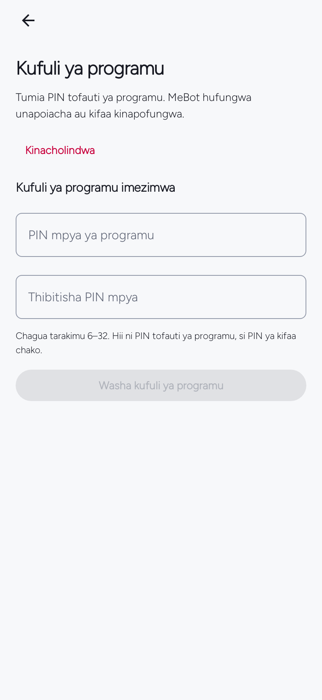</a>
</p>

**Follow what matters** · **Make it yours** · **Optional app lock**
<p align="center">
<a href="docs/screenshots/v082/feed.png"></a>
<a href="docs/screenshots/v082/news.png">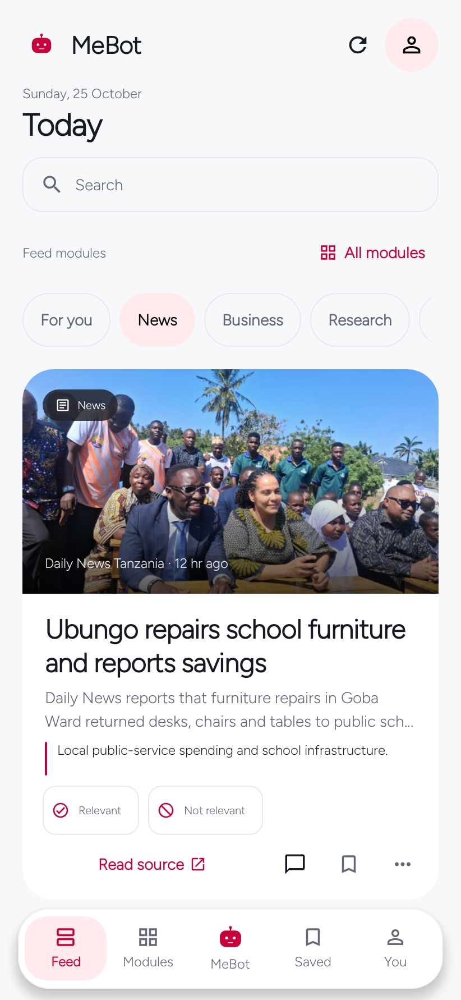</a>
<a href="docs/screenshots/v082/detail-answer.png"></a>
</p>

**Your first edition** · **News near you** · **Read and keep exploring**
<p align="center">
<a href="docs/screenshots/v082/detail-streaming.png">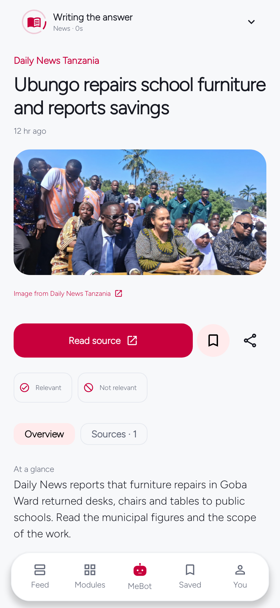</a>
<a href="docs/screenshots/v082/mebot.png">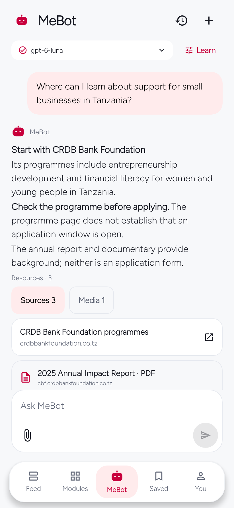</a>
<a href="docs/screenshots/v082/welcome.png">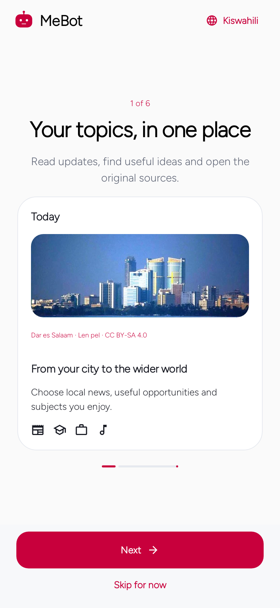</a>
</p>

**A clear start to each story** · **Ask MeBot** · **A familiar starting point**
<p align="center">
<a href="docs/screenshots/v082/interests.png">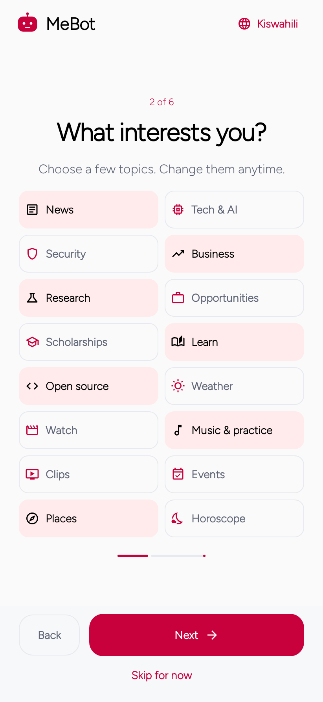</a>
<a href="docs/screenshots/v082/daily-tools.png"></a>
<a href="docs/screenshots/v082/modules.png">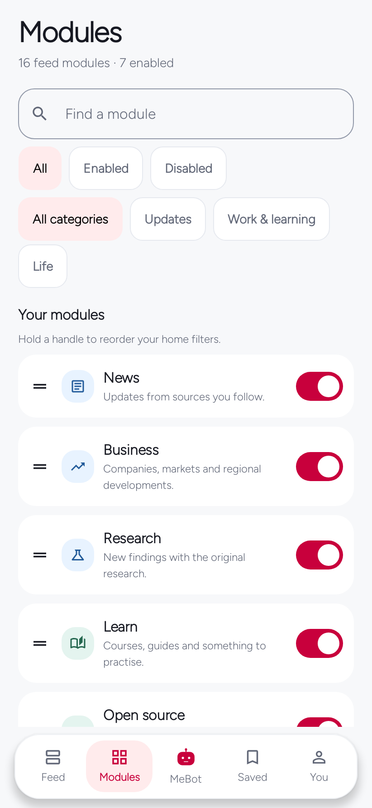</a>
</p>

**Choose what matters** · **Three optional daily tools** · **Explore the catalog**
<p align="center">
<a href="docs/screenshots/v082/providers.png">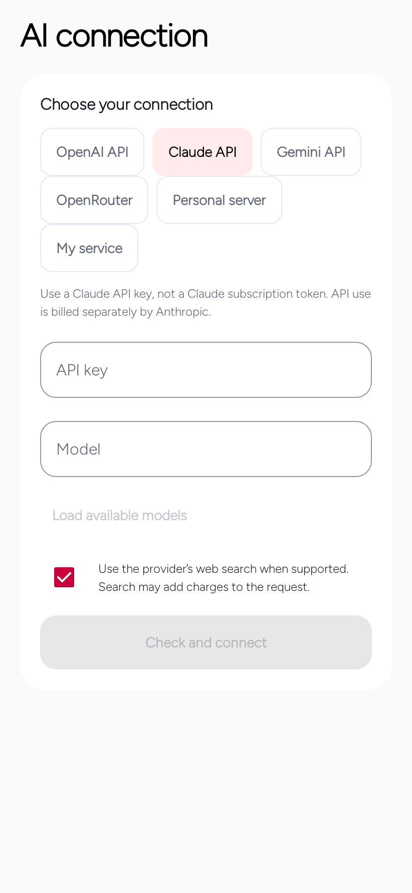</a>
<a href="docs/screenshots/v082/usage.png">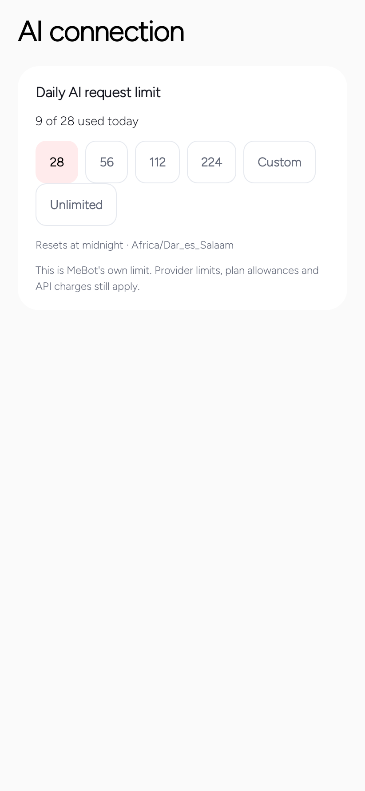</a>
<a href="docs/screenshots/v082/background.png"></a>
</p>

**Choose your connection** · **Keep usage in view** · **Set the pace**
<p align="center">
<a href="docs/screenshots/v082/software-updates.png"></a>
<a href="docs/screenshots/v082/my-mebot.png">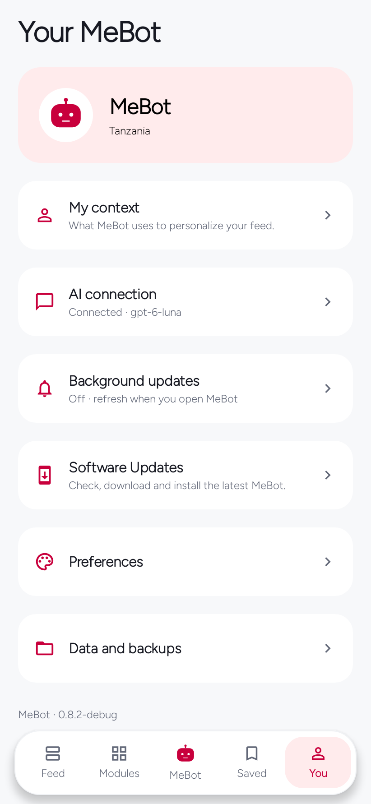</a>
<a href="docs/screenshots/v082/learning.png">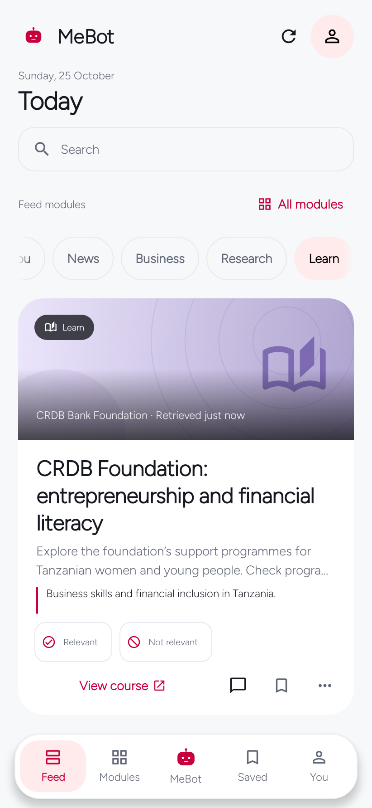</a>
</p>

**Software Updates** · **Your own setup** · **Discover beyond headlines**
<p align="center">
<a href="docs/screenshots/v082/about.png">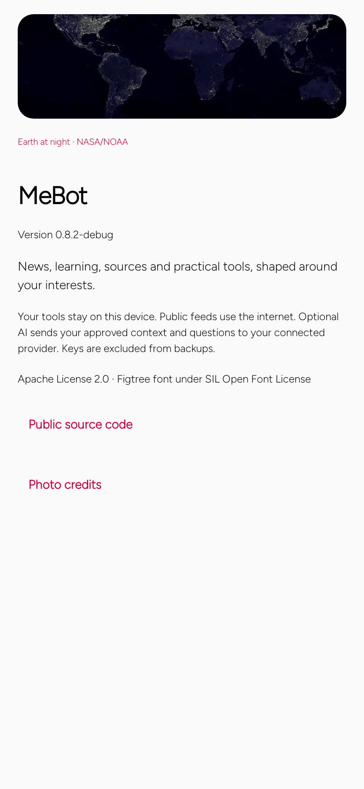</a>
</p>

**About MeBot**

Captured 25–26 October 2026 from native Android host journeys. The imported-notes screenshots use synthetic fixtures; feed examples use dated public reporting. These are **not live account sessions or physical-device photographs**. [Sources and capture notes](docs/screenshots/README.md) · [Image credits](docs/IMAGE-CREDITS.md).

## Choose your AI connection

| Connection | What it means |
| --- | --- |
| ChatGPT | Existing provider-authorized sign-in for eligible accounts; account/model policy applies. No access to ChatGPT memory or chats is implied. |
| OpenAI API | Explicit API key with separate API billing. |
| Claude | Anthropic API key. Claude.ai subscription credentials are not used by third-party MeBot. |
| Gemini | Gemini API key. This adapter uses the public source material supplied by MeBot; it does not claim native Google Search grounding. |
| OpenRouter | PKCE authorization with a one-time code return or API key; uses OpenRouter credits, not an imported Claude subscription. |
| Personal server | Explicit OpenAI-compatible endpoint and model. Features depend on the endpoint; a saved key is never sent over HTTP. |
| Personal service | Optional self-hosted Python service. The service currently uses its own OpenAI API adapter. |

Provider selection is explicit. No automatic switching to a separately billed provider. Model lists, completed-response checks, streaming support and source discovery follow each adapter’s capabilities. Provider credentials stay outside portable exports.

**Copy starter prompt** prepares the exact preferences JSON schema for any suitable assistant. Review imports before applying. Onboarding interests already count as personalization.

## What is included

| Area | Behavior |
| --- | --- |
| Feed | Completed modules publish immediately; new results wait behind Show new items while you read. Expired source-verified forecasts/events leave active reading; saved and starred records stay. |
| Feedback & fit | Relevant / Not relevant improves module suggestions with undo and reset. Optional bounded AI fit can help match up to eight public stories per module; it is not a probability or promise. |
| Item detail | Stable introduction, unclipped square answer surface, streaming explanations and grouped sources/media/files. |
| Activity | One fixed top panel with an anchor-width popover; real events and provider-published summaries, never invented thoughts. |
| Connection | Provider and model choice, one persisted request budget, presets/custom/unlimited and clear capability limits. |
| Background | Timing, preparation batches, Wi-Fi/battery conditions, notifications and quiet hours in actionable cards. |
| Software Updates | Automatic checks and optional Wi-Fi preparation, verified package/version/certificate/hash, and Android’s installer approval. |
| Guidance | One relevant dismissible setup notice, a short first-use tour and replay from Help. |
| Daily tools | Alarm, Focus and Daily Check-in; independent of AI. |
| Data | Clear reading history explains its scope before confirmation; saved items, conversations and relevance feedback are separate. |

## Install and use

[Download the official APK](https://github.com/EmmanuelMmanda/MeBot/releases/download/v0.9.4/mebot-0.9.4.apk). Updating from a 0.9.x release preserves your existing installation; do not uninstall or clear app data. Choose interests, connect a provider when ready, then open Feed. Test any configured alarm on your phone before overnight reliance. [Start here](START-HERE.md).

## Verification and release files

[Verification report](https://github.com/EmmanuelMmanda/MeBot/releases/download/v0.9.4/MeBot-0.9.4-verification.md) · [Exact source snapshot](https://github.com/EmmanuelMmanda/MeBot/releases/download/v0.9.4/MeBot-0.9.4-source.zip) · [Release notes](https://github.com/EmmanuelMmanda/MeBot/releases/download/v0.9.4/RELEASE-NOTES.md) · [Checksums](https://github.com/EmmanuelMmanda/MeBot/releases/download/v0.9.4/SHA256SUMS.txt) · [Native gallery](docs/screenshots/README.md).

The current application source is commit `54ca9e0f86f5616f7f5a8138bec4ea1e97f2fa8e` (tree `6c51dc2758c89fb93830169c535a2993b72ec700`). The source archive preserves its original local build commit; see the verification report for the mapping.

Tests use controlled providers and native Android host journeys. Real account eligibility, physical playback, file-picker behavior and overnight alarms need device checks. Historical releases are preserved. No private profile or signing key is published.

## Build

JDK **17**, Gradle **8.13**, Android SDK **36**, Build Tools **35.0.0**.

```sh
git clone https://github.com/EmmanuelMmanda/MeBot.git
cd MeBot
git switch develop
python3 scripts/prepare-build.py
./gradlew :core:test :app:testDebugUnitTest :app:assembleRelease :app:lintRelease
```

The preparation script retrieves pinned typography and generates original alarm tones. Release signing uses private `MEBOT_*` environment values; debug builds need no key. Use `mebot.buildJdk=21` only for a local JDK21 environment; official CI uses17. Source archives intentionally omit font binaries and build outputs.

```sh
cd service
python3 -m venv .venv
.venv/bin/pip install -r requirements-dev.txt
.venv/bin/python -m pytest -q
```

## Project structure

`core/` contains domain models, validation, feedback and recommendation policy. `app/` contains Compose UI, Android lifecycle, providers, local tools, secure storage and software updates. `service/` is an optional backend. `docs/` includes illustrated guides, capture provenance and the static website. `.github/` contains verification and publication workflows.

Work on develop, verify, then promote to main. iOS/multiplatform implementation is **not included** in this release.

[Contributing](CONTRIBUTING.md) · [Security](SECURITY.md) · [Privacy](docs/PRIVACY.md) · [Architecture](docs/ARCHITECTURE.md) · [Build guide](docs/BUILD.md) · [Release history](docs/PUBLIC-RELEASES.md).

## License

[Apache 2.0](LICENSE). Third-party material retains its own [notices](NOTICE) and [image credits](docs/IMAGE-CREDITS.md). MeBot is independent and is not endorsed by OpenAI, Anthropic, Google or any publisher. Documentation hosting is independent of the package identifier.
