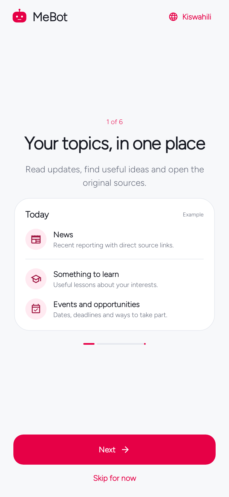
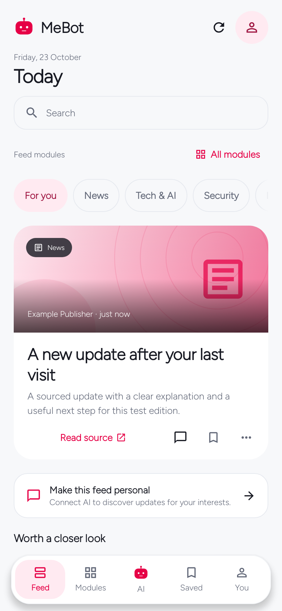
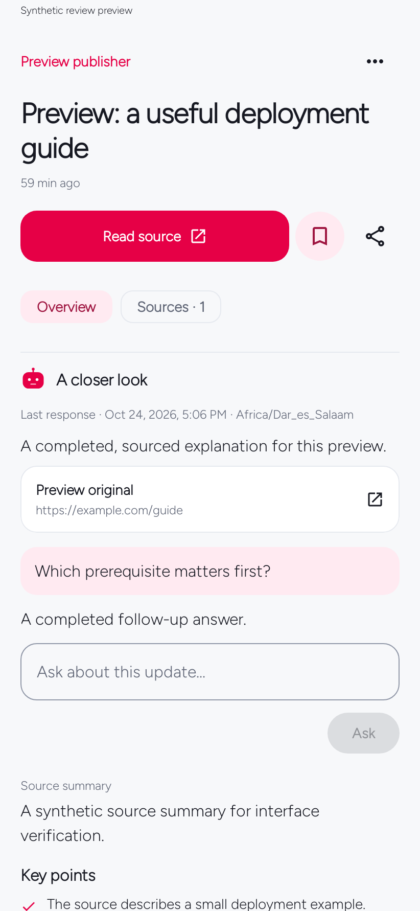
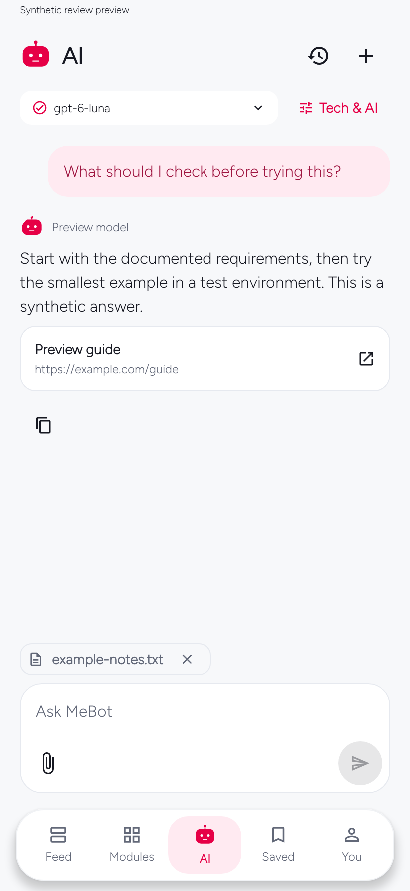
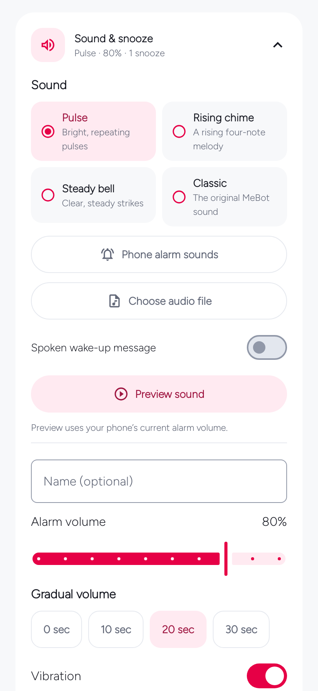
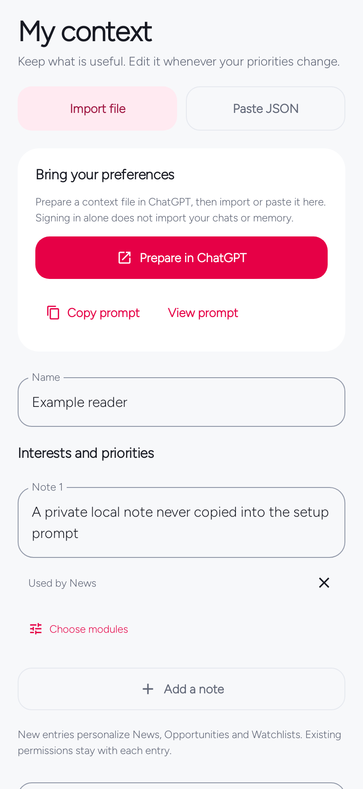
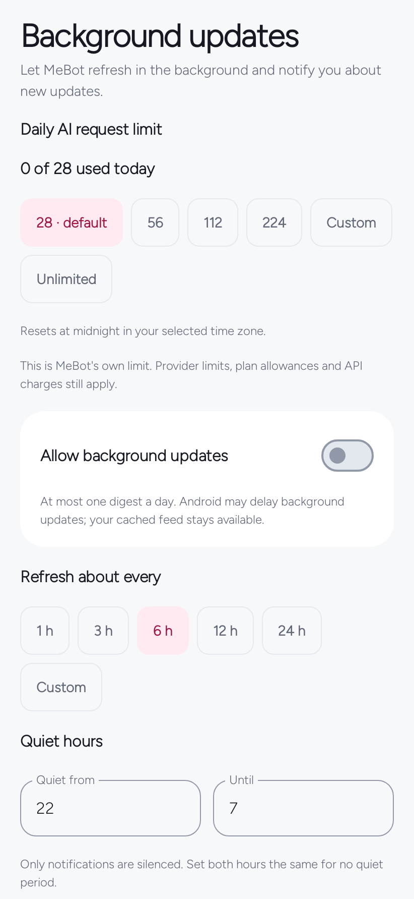
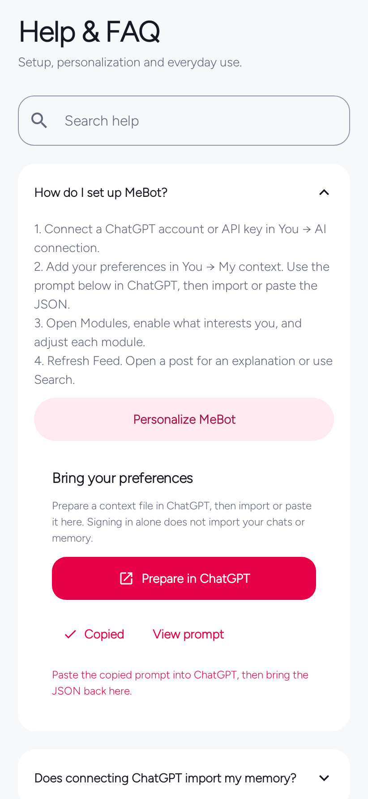

# MeBot Daily

> **Testing release: 0.7.0-beta.1.** [Download the APK](https://github.com/EmmanuelMmanda/MeBot/releases/download/v0.7.0-beta.1/mebot-0.7.0-beta.1.apk) · [Release notes and limits](docs/RELEASE-0.7.0-beta.1.md) · [Recommendation engine](docs/RECOMMENDATIONS.md). This installs as **MeBot Test** alongside stable MeBot; it does not replace or migrate your existing installation automatically.

**A native Android app for a personal feed, useful AI answers, and everyday tools.**

Choose the subjects you care about. Read a short edition with images and sources. Open a story for an automatic streamed explanation, ask a follow-up, or search across your modules. Alarms, focus and a daily check-in work independently of AI.

[Documentation](https://emmanuelmmanda.github.io/MeBot/) · [Get the app](https://emmanuelmmanda.github.io/MeBot/download.html) · [User guide](docs/USER-GUIDE.md) · [Releases](https://github.com/EmmanuelMmanda/MeBot/releases) · [Contributing](CONTRIBUTING.md)

Native Kotlin + Jetpack Compose · Android 8.0+ · English and Kiswahili · Apache-2.0

## A look inside

<p align="center">
  
  
  
</p>

<p align="center">
  
  
  
</p>

These are actual Android interface renders using synthetic test content. They are not live account responses. The [screenshot index](docs/screenshots/README.md) identifies each screen, version, fixture and image credit. More screens appear in the documentation, including search, context, background settings, FAQ and narrow Kiswahili layouts.

## Use your ChatGPT subscription

**Continue with ChatGPT** is MeBot's primary AI setup. Eligible accounts can authorize supported models through their plan where OpenAI makes that integration available. Eligibility and limits are controlled by the provider, not by MeBot. MeBot opens the official sign-in in your browser, discovers the models available to that account, and checks a completed response before activating the connection.

That connection powers personalized module updates, automatic story explanations, follow-up questions, the AI workspace and search. Web search and model availability depend on the selected model and account policy. Subscription limits still apply. See OpenAI's [quickstart](https://developers.openai.com/siwc/quickstart) and [current limitations](https://developers.openai.com/siwc/token-sharing-open-source/preview-limitations).

Sign-in does **not** give MeBot your ChatGPT conversations or memory. Personalization starts with topics and interests you choose during onboarding; reviewed context imports are optional. The app includes a copyable prompt to prepare that context in ChatGPT; you stay in control of which modules may use each note.

An **API key** is an explicit alternative with separate provider billing. The optional self-hosted service also uses an API key. MeBot never switches a failed subscription request to paid API mode automatically. The full [connection guide](docs/CHATGPT-CONNECTION.md) explains consent, models, renewal, privacy and recovery.

## Start in a few minutes

1. **Install the APK** from the [latest release](https://github.com/EmmanuelMmanda/MeBot/releases/latest). Android 8.0 or later is required. Public packages start without a personal profile. The current beta installs separately; retain your existing MeBot. Only updates signed with the same key and package identity can update an existing install.
2. **Open the six-step tour or skip it.** Public sources and local tools are available without an AI account. Open **Modules** to see everything available and enable what interests you.
3. **Connect AI:** **You → AI connection → Continue with ChatGPT**. Finish consent, return to MeBot and wait for the account/model check. Use **Check connection** to retry a saved account.
4. **Choose your interests during onboarding.** Add an optional city and a short preference. Later, **You → My context** offers optional **Import file**, **Paste JSON**, or a compact ChatGPT preparation prompt. Review imports before applying.
5. **Open Feed.** Read the first five stories, open one for its explanation, ask a follow-up, or search. **Show more** reveals the next cached items. Tapping the active Feed tab returns to the top and refreshes.

The [illustrated guide](https://emmanuelmmanda.github.io/MeBot/guide.html) covers the complete setup, every module and common problems. The same essentials are available offline under **You → Preferences → Help & FAQ**.

## What is included

| Area | What you can do |
| --- | --- |
| **Feed** | Read a five-story starting edition, view publisher images and source links, filter by module, save or hide items, and load more without another AI request. |
| **Modules** | Discover all available modules, filter enabled/disabled or by category, reorder the home filters, and customize each module's focus, preferences and allowed context. |
| **Story detail** | Start an AI explanation automatically, keep its citations, ask follow-ups, and return to a completed cached explanation. |
| **Search** | Enter a question or phrase across enabled factual modules, or choose a single module. Open, save and explore the sourced results. |
| **AI workspace** | Keep conversations, select module context, attach reviewed text/Markdown files, and use compatible phone voice input or read-aloud. |
| **Saved** | Reopen saved reading and locally retained content when a provider or network is unavailable. |
| **You** | Review context, manage AI accounts and models, choose appearance and language, set delivery and request limits, and manage backups and data. |
| **Local tools** | Use Math/QR/Tap alarms, selectable audio and optional spoken wake-up messages, focus sessions and a brief daily check-in without an AI connection. |

The feed catalog covers **News, Tech & AI, Security, Opportunities, Scholarships, Business, Research, Learn, Watch, Music & practice, Events, Places, Weather, Open source, Horoscope and Clips**, plus **custom Watchlists** (16 built-ins and 17 module kinds). Each kind has a default brief; customization adds your selected preferences without making you write a research prompt. Horoscope is optional entertainment. Local tools are separate from feed modules.

Discovery uses connected AI with source checks, direct public adapters for Open-Meteo, GitHub and Hacker News, and optional configured RSS feeds. Publisher metadata supplies media; model-generated image URLs are not trusted as publisher images. Every resource keeps a direct source link. [How discovery works →](docs/DISCOVERY-MEDIA.md)

## Preferences that stay yours

<p align="center">
  
  
  
</p>

- **Explicit context.** Import validated MeBot context JSON, inspect the replacement preview, and choose relevant module scopes. `modules: []` keeps your current module choices. A whole ChatGPT export ZIP is not an import format.
- **Optional background refresh.** Choose an interval, notifications and quiet hours. New profiles start at **28 attempted AI requests per local day**; 56, 112, 224, a custom amount and Unlimited are available. Unlimited removes the app's local cap, while provider and service limits still apply.
- **Local control.** Cached reading and local tools remain available without AI. Credentials use Android Keystore and are excluded from portable backups. The app has no analytics service. Requests still go to the AI provider or source you choose.
- **Bounded storage.** Feed state, explanation reuse, image caches and diagnostics have size or retention limits. Context import, feed backup and local-tool backup have separate review and restore behavior.

Read the [privacy guide](docs/PRIVACY.md), [context example](docs/context-example.json) and [data controls](docs/USER-GUIDE.md) before sharing a backup. A personal profile can contain sensitive information even when it contains no API key.

## Releases and verification

The current application version is **0.6.1**, version code **8**. It adds the six-step tour, module discovery, context preparation and FAQ, flexible request limits, feed usability polish, and alarm sound/voice choices. The [changelog](CHANGELOG.md) and [release archive](https://emmanuelmmanda.github.io/MeBot/releases.html) describe earlier versions.

Historical release tags point to their original source commits. Available public APKs exclude the optional personal starter-profile asset and retain the original application's signing identity. Each release identifies its available artifacts, SHA-256 checksums and verification record. A source-only version is labelled as such; missing historical binaries are not invented.

The 0.6.1 application gate completed **646 tests**: 116 core, 385 Android and 145 service tests, with no failures, errors or skipped tests. Debug and release lint reported **0 errors**, with existing advisory warnings recorded. Tests use controlled providers and native host-rendered UI; live subscription authorization and physical-phone alarm behavior require device checks. See [verification](docs/VERIFICATION.md) and [public distribution checks](docs/PUBLIC-RELEASES.md).

The release package keeps application ID `app.mynguli` for upgrade compatibility. Official APKs use the certificate fingerprint recorded in [release integrity](docs/release-integrity.json). A fork signed with a different key cannot replace the official installation.

## Build from source

Use **JDK 17**, Android SDK **36**, Build Tools **35.0.0** and the checked-in Gradle **8.13** wrapper. No personal asset, API key or signing key is needed for a development build.

```sh
git clone https://github.com/EmmanuelMmanda/MeBot.git
cd MeBot
git switch develop
./scripts/build.sh verify
```

The debug APK is written to `app/build/outputs/apk/debug/app-debug.apk` and uses application ID `app.mynguli.debug` so it can coexist with the release app.

For the optional service:

```sh
cd service
python3 -m venv .venv
.venv/bin/python -m pip install -r requirements-dev.txt
.venv/bin/python -m pytest -q
```

The [build guide](docs/BUILD.md) covers SDK setup, signed builds and device acceptance. The [development guide](docs/DEVELOPMENT.md) covers configuration, adding modules, architecture and verification. The [service guide](service/README.md) explains running your own API-key backend; no hosted backend is bundled or implied.

## Project layout

| Path | Responsibility |
| --- | --- |
| `core/` | State, validation, relevance, context rules, backups, daily/focus logic and alarm recurrence. |
| `app/` | Native Compose UI, Android persistence, provider connections, sources, scheduling, media and alarm runtime. |
| `service/` | Optional single-person Python service with SQLite, provider isolation, caching and limits. |
| `docs/` | GitHub Pages site, illustrated usage guides, technical contracts and verification records. |
| `scripts/` | Build entry points, original alarm-tone generator and documentation checks. |
| `.github/` | Android/service verification, documentation deployment and contribution templates. |

Work on **develop**, validate, then promote to **master**. Pull requests use automated checks without production credentials. Public builds must omit personal profiles, local exports and signing material. Report normal bugs through [Issues](https://github.com/EmmanuelMmanda/MeBot/issues); handle sensitive findings according to [SECURITY.md](SECURITY.md).

## License and credits

Application and service source are licensed under [Apache-2.0](LICENSE). Figtree is licensed under the [SIL Open Font License](docs/FONT-LICENSE.txt). Bundled alarm tones are original reproducible assets; see [alarm audio](docs/ALARM-AUDIO.md). Third-party libraries and publisher-image rights are described in [NOTICE](NOTICE) and the [screenshot credits](docs/screenshots/README.md).

MeBot is an independent application. ChatGPT is a service of OpenAI; the integration does not imply OpenAI sponsorship or endorsement.

## Build the test candidate

Use JDK 17, Android SDK 36 and Gradle 8.13. Run `python3 scripts/prepare-build.py`, then `gradle :core:test :app:testDebugUnitTest :app:assembleBeta :app:lintBeta`. The beta is separately installed as `app.mynguli.beta`; release signing is configured only through private environment variables. Build-resource binaries are fetched from the pinned upstream and verified rather than included in the source archive.
