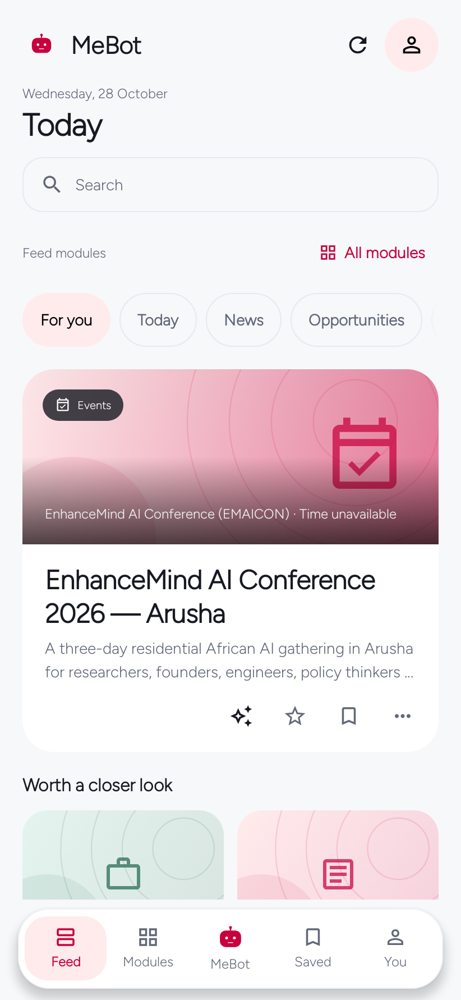
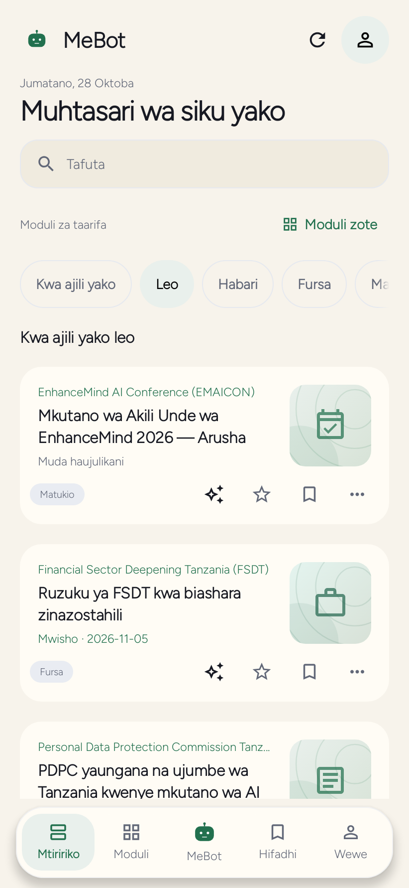
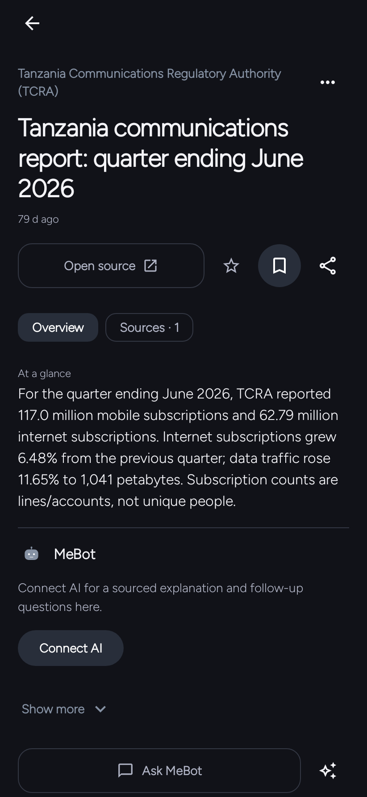
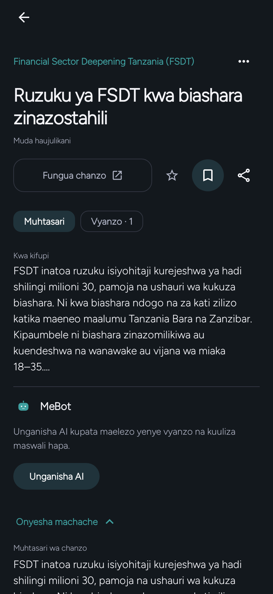
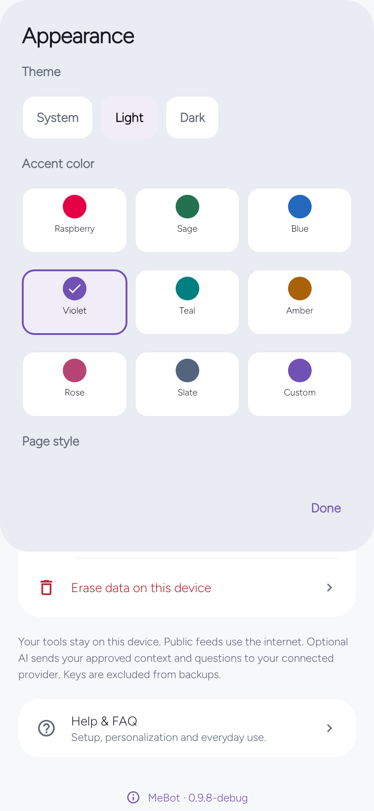
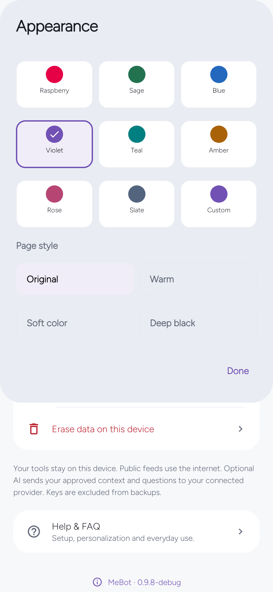
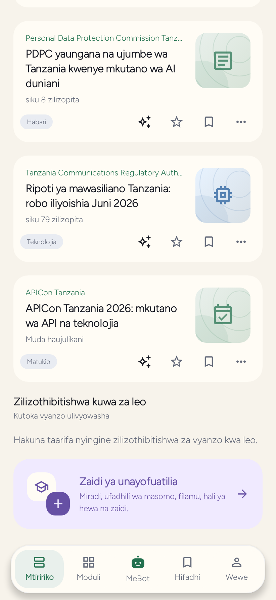

<div align="center"><h1>MeBot</h1><p>Read with purpose. Choose your next step.</p><p>Android · English &amp; Kiswahili · Apache 2.0</p></div>

> **MeBot 0.9.8 is available now.** Update in the app or [download the official APK](https://github.com/EmmanuelMmanda/MeBot/releases/download/v0.9.8/mebot-0.9.8.apk). [Installation and verification](docs/download.html).

## Explore MeBot

Open Suggestions when you want another angle. Explicit generation prepares five distinct questions with your connected AI. Send asks the selected question; the pencil lets you edit first. Opening or closing the sheet never sends a question. Without AI, questions are unavailable, while public reading and saved items remain usable.

Original Reads are clearly labelled AI-authored, with Created dates rather than publisher dates. Read the complete sections, inspect evidence, and explore optional further reading separately. Today keeps your personal selection distinct from verified source-day stories; an undated source is not relabelled as published today.

Choose eight accent colours or your own, with Original, Warm, Soft colour and Deep black page styles. Your phone’s theme, light and dark are supported; Deep black applies in dark mode.

## See MeBot

<p align="center"><a href="docs/screenshots/v098-showcase/en-feed-light-ember.png"></a>
<a href="docs/screenshots/v098-showcase/sw-today-light-sage.png"></a>
<a href="docs/screenshots/v098-showcase/en-detail-dark-slate.png"></a></p>

**Read what matters** — en, Light · Raspberry · Original · **Kwa ajili yako leo** — sw, Light · Sage · Warm · **The source and its caveats** — en, Dark · Slate · Original
<p align="center"><a href="docs/screenshots/v098-showcase/sw-opportunity-dark-teal.png"></a>
<a href="docs/screenshots/v098-showcase/en-appearance-light-violet.png"></a>
<a href="docs/screenshots/v098-showcase/en-appearance-page-style-light-violet.png"></a></p>

**Fursa, kwa Kiswahili** — sw, Dark · Teal · Soft colour · **Your colours, your comfort** — en, Light · Violet · Original · **A page style that suits you** — en, Light · Violet · Original
<p align="center"><a href="docs/screenshots/v098-showcase/sw-today-verified-light-sage.png"></a></p>

**Leo, bila kubuni tarehe** — sw, Light · Sage · Warm

Native Android host renders of the 0.9.8 debug preview build using a static editorial fixture built from source-verified public facts; no live feed refresh is shown. Sources were checked on 28 October 2026; a checked date is not a publication date. These are not live provider responses, personal accounts or physical-device acceptance evidence. [Capture sources](docs/screenshots/v098-showcase/README.md). Historical screenshots remain evidence only, outside this current gallery.

## Installation and release identity

[Published 0.9.8 APK](https://github.com/EmmanuelMmanda/MeBot/releases/download/v0.9.8/mebot-0.9.8.apk) · [Published release files](https://github.com/EmmanuelMmanda/MeBot/releases/tag/v0.9.8) · [Start here](START-HERE.md) · [User guide](docs/USER-GUIDE.md).

Install an eligible update over your existing production 0.9.x app. Do not uninstall or clear data. Older separately installed builds have different package or signing identities; see the installation guide before replacing them. Package: `mebot.nguli.com`. The published APK source is `b081584d68413bcda330f23d760474871ea705de`, tree `f7f98aaab2b754931dde9ad1c962fdf9b0540bc1`. This identifies the published APK; the gallery retains its separate debug-build capture provenance. Technical evidence is separate from experience-first release notes.

## Choose your AI connection

| Connection | What it means |
| --- | --- |
| ChatGPT | Existing provider-authorized sign-in for eligible accounts; account/model policy applies. No access to ChatGPT memory or chats is implied. |
| OpenAI API | Explicit API key with separate API billing. |
| Claude | Anthropic API key. Claude.ai subscription credentials are not used by third-party MeBot. |
| Gemini | Gemini API key. This adapter uses the public source material supplied by MeBot; it does not claim native Google Search grounding. |
| OpenRouter | PKCE authorization with a one-time code return or API key; uses OpenRouter credits, not an imported Claude subscription. |
| Personal server | Explicit OpenAI-compatible endpoint and model. Features depend on the endpoint; a saved key is never sent over HTTP. |
| Personal service | Optional self-hosted Python service. The service currently uses its own OpenAI API adapter. |

Provider selection is explicit. No automatic switching to a separately billed provider. Model lists, completed-response checks, streaming support and source discovery follow each adapter’s capabilities. Provider credentials stay outside portable exports.

**Copy starter prompt** prepares the exact preferences JSON schema for any suitable assistant. Review imports before applying. Onboarding interests already count as personalization.

## What is included

| Area | Behavior |
| --- | --- |
| Feed | Completed modules publish immediately; new results wait behind Show new items while you read. Expired source-verified forecasts/events leave active reading; saved and starred records stay. |
| Feedback & fit | Relevant / Not relevant improves module suggestions with undo and reset. Optional bounded AI fit can help match up to eight public stories per module; it is not a probability or promise. |
| Item detail | Stable introduction, unclipped square answer surface, streaming explanations and grouped sources/media/files. |
| Activity | One fixed top panel with an anchor-width popover; real events and provider-published summaries, never invented thoughts. |
| Connection | Provider and model choice, one persisted request budget, presets/custom/unlimited and clear capability limits. |
| Background | Timing, preparation batches, Wi-Fi/battery conditions, notifications and quiet hours in actionable cards. |
| Software Updates | Automatic checks and optional Wi-Fi preparation, verified package/version/certificate/hash, and Android’s installer approval. |
| Guidance | One relevant dismissible setup notice, a short first-use tour and replay from Help. |
| Daily tools | Alarm, Focus and Daily Check-in; independent of AI. |
| Data | Clear reading history explains its scope before confirmation; saved items, conversations and relevance feedback are separate. |

## Build

JDK **17**, Gradle **8.13**, Android SDK **36**, Build Tools **35.0.0**.

```sh
git clone https://github.com/EmmanuelMmanda/MeBot.git
cd MeBot
git switch develop
python3 scripts/prepare-build.py
./gradlew :core:test :app:testDebugUnitTest :app:assembleRelease :app:lintRelease
```

Tests use controlled providers. Real account access, physical-phone media, file pickers and overnight alarms require device checks. No private profile, provider credential or signing key belongs in public source. See [Build](docs/BUILD.md), [Contributing](CONTRIBUTING.md), [Privacy](docs/PRIVACY.md), and [Security](SECURITY.md).

[Apache 2.0](LICENSE). Third-party content retains its own [notices](NOTICE) and [credits](docs/IMAGE-CREDITS.md). MeBot is independent, not endorsed by any provider or publisher.
