<div align="center">

<h1>MeBot Daily</h1>
<p>A native Android app for your topics, sourced AI answers and everyday tools.</p>
<p><a href="https://emmanuelmmanda.github.io/MeBot/"><strong>Website &amp; user guide</strong></a> · <a href="https://github.com/EmmanuelMmanda/MeBot/releases/download/v0.8.1/mebot-0.8.1.apk"><strong>Download APK</strong></a> · <a href="https://github.com/EmmanuelMmanda/MeBot/releases">Releases</a> · <a href="https://emmanuelmmanda.github.io/MeBot/screenshots.html">Screenshot gallery</a></p>
<p>Android 8.0+ · English &amp; Kiswahili · Kotlin + Jetpack Compose · Apache 2.0</p>
</div>

> **Current release: 0.8.1 · 15.9 MB.** The original official MeBot can be updated in place. The earlier **MeBot Test** remains a separate app. [Installation and limits](https://emmanuelmmanda.github.io/MeBot/download.html).

Choose the subjects you care about. Read a source-linked feed, open a story for an explanation, search, or ask a follow-up. Alarms, focus and check-in remain optional tools, not the whole app.

## See the app

<p align="center">
  <a href="docs/screenshots/v081/mebot-0.8.1-ai-resources.png">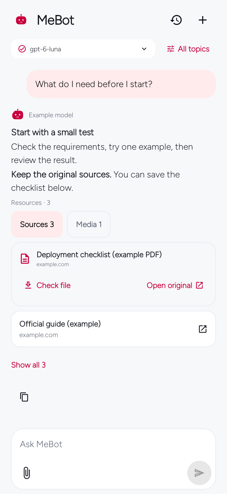</a>
  <a href="docs/screenshots/v081/mebot-0.8.1-streaming.png">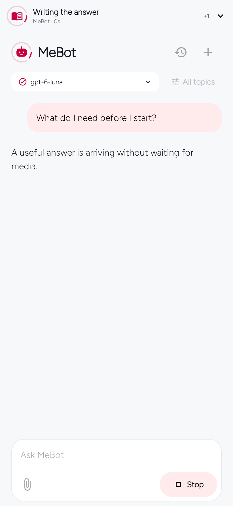</a>
  <a href="docs/screenshots/v081/mebot-0.8.1-detail-files.png">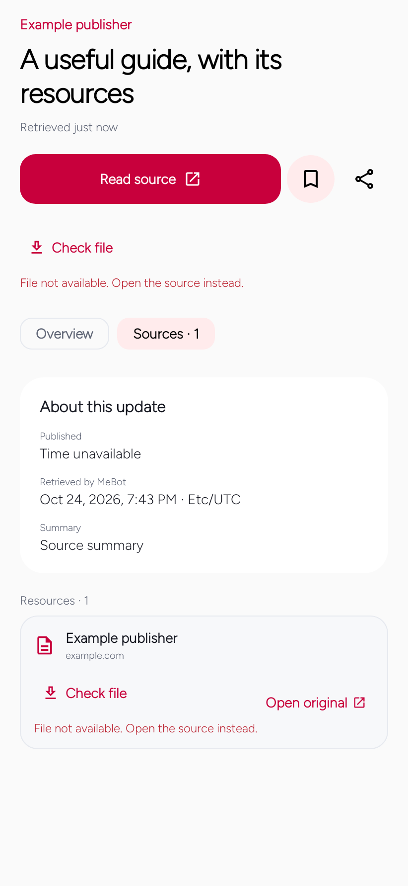</a>
</p>

**Answers with useful files** (0.8.1) · **One place for AI activity** (0.8.1) · **Keep the story and its sources** (0.8.1)
<p align="center">
  <a href="docs/screenshots/v081/mebot-0.8.1-appearance.png">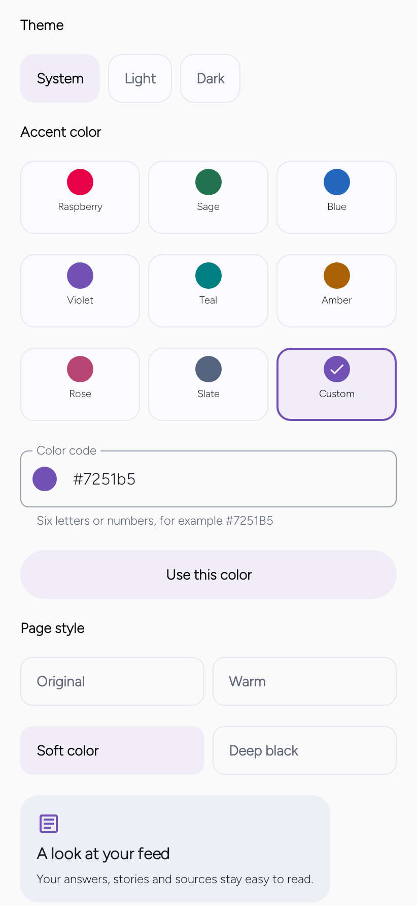</a>
  <a href="docs/screenshots/v070/feed.png"></a>
  <a href="docs/screenshots/v070/detail.png"></a>
</p>

**Colours that feel like you** (0.8.1) · **Your personal feed** (0.7.0 beta) · **Read a little closer** (0.7.0 beta)
<p align="center">
  <a href="docs/screenshots/v070/ai.png"></a>
  <a href="docs/screenshots/v070/welcome.png"></a>
  <a href="docs/screenshots/v070/interests.png">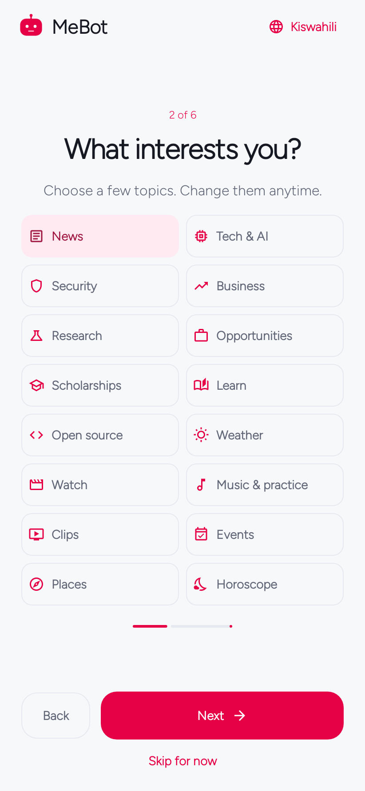</a>
</p>

**Ask MeBot** (0.7.0 beta) · **A short welcome** (0.7.0 beta) · **Choose your interests** (0.7.0 beta)
<p align="center">
  <a href="docs/screenshots/v070/preferences.png">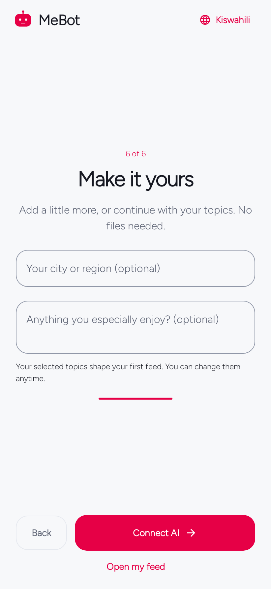</a>
  <a href="docs/screenshots/v070/background.png">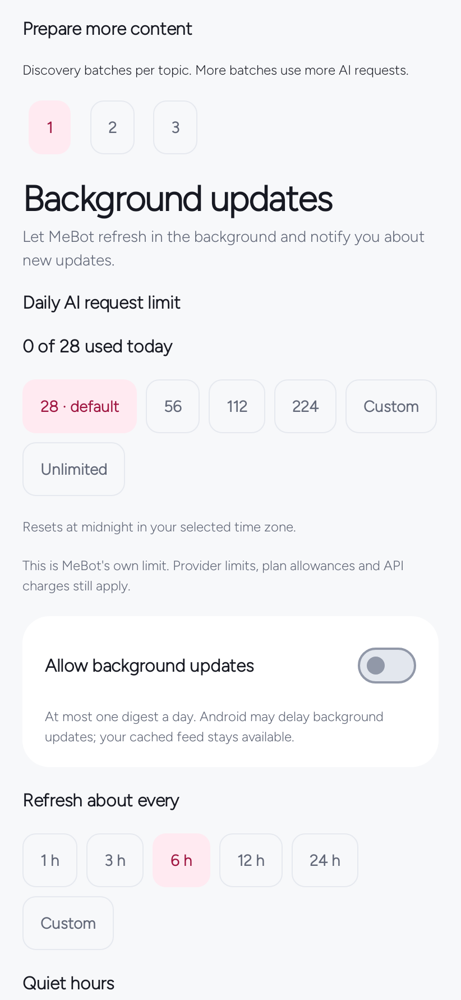</a>
  <a href="docs/screenshots/54-mebot-module-discovery-v061.png"></a>
</p>

**Make it yours** (0.7.0 beta) · **Set your pace** (0.7.0 beta) · **Discover modules** (0.6.1)
<p align="center">
  <a href="docs/screenshots/52-mebot-search-v06.png">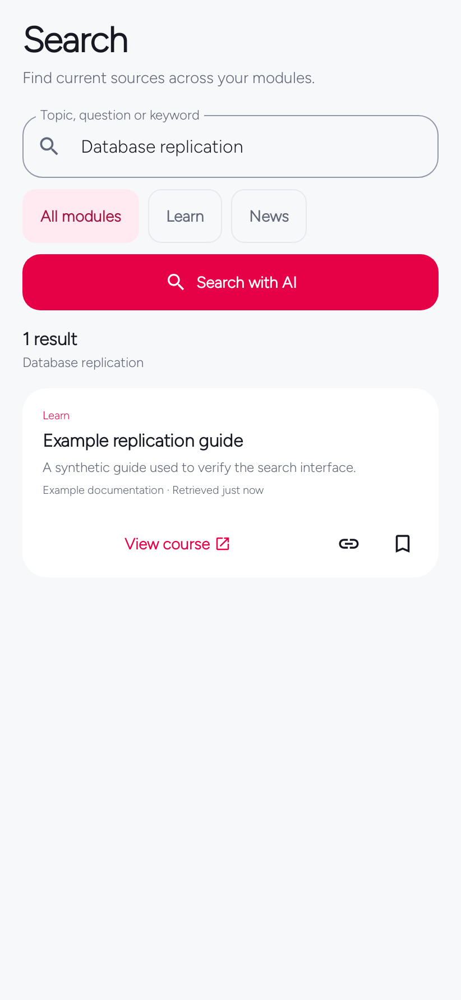</a>
  <a href="docs/screenshots/69-mebot-alarm-audio-v061.png"></a>
  <a href="docs/screenshots/60-mebot-context-v061.png"></a>
</p>

**Search your topics** (0.6.0) · **Choose your alarm sound** (0.6.1) · **Review your preferences** (0.6.1)
<p align="center">
  <a href="docs/screenshots/61-mebot-faq-v061.png"></a>
  <a href="docs/screenshots/70-mebot-alarm-audio-small-sw-v061.png">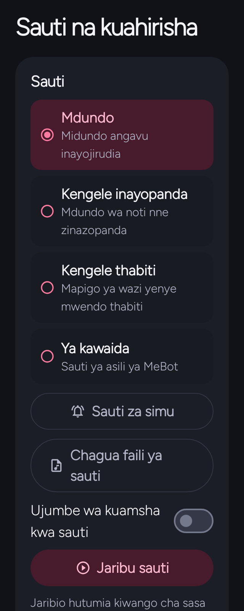</a>
  <a href="docs/screenshots/50-mebot-module-order-v06.png">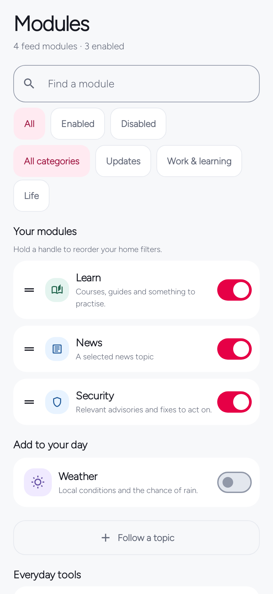</a>
</p>

**Find a clear answer** (0.6.1) · **Kiswahili on a small screen** (0.6.1) · **Keep your order** (0.6.0)
<p align="center">
  <a href="docs/screenshots/44-mebot-connection-polish-v051.png">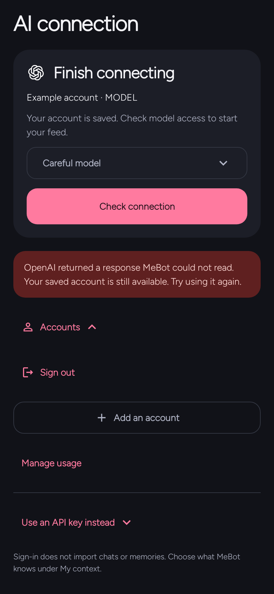</a>
  <a href="docs/screenshots/v081/mebot-0.8.1-detail-working.png">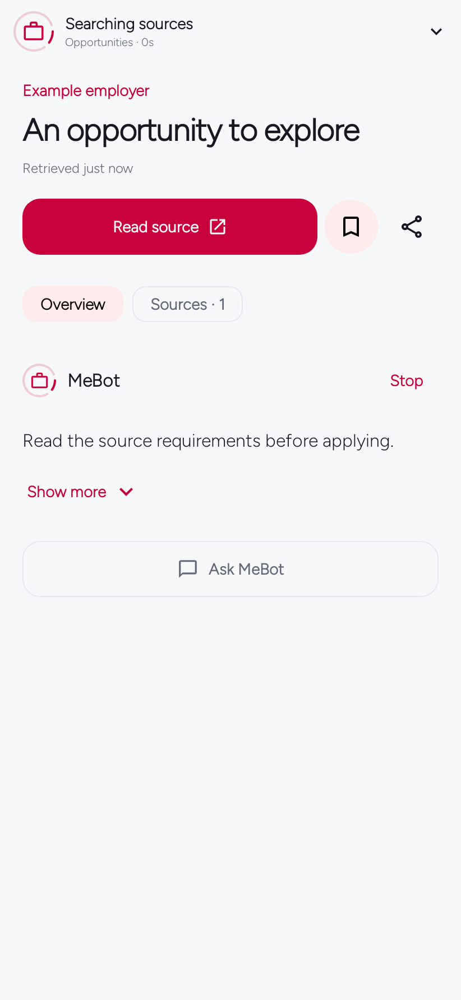</a>
</p>

**Connect an AI account** (0.5.1) · **Read while MeBot searches** (0.8.1)

These are **actual native Android renders with synthetic example content**, not live AI responses or physical-phone photographs. Current 0.8.1 screens are shown with their capture version. Supporting screens are labelled by their capture version. Select any image for the full-size original. The [web gallery](https://emmanuelmmanda.github.io/MeBot/screenshots.html) includes captions, filters and keyboard-accessible enlargement. [Capture notes and image credits](docs/screenshots/README.md).

## Use your ChatGPT subscription

**Continue with ChatGPT** is MeBot's primary AI setup. Eligible accounts can authorize supported models through their plan where OpenAI makes that integration available. Eligibility and limits are controlled by the provider, not by MeBot. MeBot opens the official sign-in in your browser, discovers the models available to that account, and checks a completed response before activating the connection.

That connection powers personalized module updates, automatic story explanations, follow-up questions, the AI workspace and search. Web search and model availability depend on the selected model and account policy. Subscription limits still apply. See OpenAI's [quickstart](https://developers.openai.com/siwc/quickstart) and [current limitations](https://developers.openai.com/siwc/token-sharing-open-source/preview-limitations).

Sign-in does **not** give MeBot your ChatGPT conversations or memory. Personalization starts with topics and interests you choose during onboarding; reviewed context imports are optional. The app includes a copyable prompt to prepare that context in ChatGPT; you stay in control of which modules may use each note.

An **API key** is an explicit alternative with separate provider billing. The optional self-hosted service also uses an API key. MeBot never switches a failed subscription request to paid API mode automatically. The full [connection guide](docs/CHATGPT-CONNECTION.md) explains consent, models, renewal, privacy and recovery.

## Start in a few minutes

1. **Install the APK** from the [latest release](https://github.com/EmmanuelMmanda/MeBot/releases/tag/v0.7.0-beta.1). Android 8.0 or later is required. Public packages start without a personal profile. This version updates original official MeBot. The earlier MeBot Test is separate. Only updates signed with the same key and package identity can update an existing install.
2. **Choose your interests, or skip the tour.** Public sources and local tools are available without an AI account. Open **Modules** to see everything available and enable what interests you.
3. **Connect AI:** **You → AI connection → Continue with ChatGPT**. Finish consent, return to MeBot and wait for the account/model check. Use **Check connection** to retry a saved account.
4. **Choose your interests during onboarding.** Add an optional city and a short preference. Later, **You → My context** offers optional **Import file**, **Paste JSON**, or a compact ChatGPT preparation prompt. Review imports before applying.
5. **Open Feed.** Read the first five stories, open one for its explanation, ask a follow-up, or search. **Show more** reveals the next cached items. Tapping the active Feed tab returns to the top and refreshes.

The [illustrated guide](https://emmanuelmmanda.github.io/MeBot/guide.html) covers the complete setup, every module and common problems. The same essentials are available offline under **You → Preferences → Help & FAQ**.

## What is included

| Area | What you can do |
| --- | --- |
| **Feed** | Read a five-story starting edition, view publisher images and source links, filter by module, save or hide items, and load more without another AI request. |
| **Modules** | Discover all available modules, filter enabled/disabled or by category, reorder the home filters, and customize each module's focus, preferences and allowed context. |
| **Story detail** | Start an AI explanation automatically, keep its citations, ask follow-ups, and return to a completed cached explanation. |
| **Search** | Enter a question or phrase across enabled factual modules, or choose a single module. Open, save and explore the sourced results. |
| **AI workspace** | Keep conversations, select module context, attach reviewed text/Markdown files, and use compatible phone voice input or read-aloud. |
| **Saved** | Reopen saved reading and locally retained content when a provider or network is unavailable. |
| **You** | Review context, manage AI accounts and models, choose appearance and language, set delivery and request limits, and manage backups and data. |
| **Local tools** | Use Math/QR/Tap alarms, selectable audio and optional spoken wake-up messages, focus sessions and a brief daily check-in without an AI connection. |

The feed catalog covers **News, Tech & AI, Security, Opportunities, Scholarships, Business, Research, Learn, Watch, Music & practice, Events, Places, Weather, Open source, Horoscope and Clips**, plus **custom Watchlists** (16 built-ins and 17 module kinds). Each kind has a default brief; customization adds your selected preferences without making you write a research prompt. Horoscope is optional entertainment. Local tools are separate from feed modules.

Discovery uses connected AI with source checks, direct public adapters for Open-Meteo, GitHub and Hacker News, and optional configured RSS feeds. Publisher metadata supplies media; model-generated image URLs are not trusted as publisher images. Every resource keeps a direct source link. [How discovery works →](docs/DISCOVERY-MEDIA.md)

## Releases and verification

The published release is **MeBot 0.8.1**, application ID `app.mynguli`, version code **12**, signed with the original release certificate. Install it over original official MeBot. The earlier **MeBot Test** is separate; export and review any data you need before removing it.

[Download the APK](https://github.com/EmmanuelMmanda/MeBot/releases/download/v0.8.1/mebot-0.8.1.apk) · [Source ZIP](https://github.com/EmmanuelMmanda/MeBot/releases/download/v0.8.1/mebot-0.8.1-source.zip) · [Screen previews](https://github.com/EmmanuelMmanda/MeBot/releases/download/v0.8.1/mebot-0.8.1-resources.zip) · [Verification report](https://github.com/EmmanuelMmanda/MeBot/releases/download/v0.8.1/mebot-0.8.1-verification.txt) · [SHA-256 checksums](https://github.com/EmmanuelMmanda/MeBot/releases/download/v0.8.1/SHA256SUMS.txt)

See the current [verification report](https://github.com/EmmanuelMmanda/MeBot/releases/download/v0.8.1/mebot-0.8.1-verification.txt) for executed tests and remaining device checks. [Release notes and limits](https://github.com/EmmanuelMmanda/MeBot/releases/tag/v0.8.1).

Older versions are development history, not claimed as published downloads. See the [release directory](https://emmanuelmmanda.github.io/MeBot/releases.html) and [changelog](CHANGELOG.md).

Personal profiles, credentials and private signing keys must not be published. See [privacy](docs/PRIVACY.md), [source distribution](docs/PUBLIC-RELEASES.md) and [security reporting](SECURITY.md).

## Build from source

Use **JDK 17**, Android SDK **36**, Build Tools **35.0.0** and the checked-in Gradle **8.13** wrapper. No personal asset, API key or signing key is needed for a development build.

```sh
git clone https://github.com/EmmanuelMmanda/MeBot.git
cd MeBot
git switch develop
./scripts/build.sh verify
```

The debug APK is written to `app/build/outputs/apk/debug/app-debug.apk` and uses application ID `app.mynguli.debug` so it can coexist with the release app.

For the optional service:

```sh
cd service
python3 -m venv .venv
.venv/bin/python -m pip install -r requirements-dev.txt
.venv/bin/python -m pytest -q
```

The [build guide](docs/BUILD.md) covers SDK setup, signed builds and device acceptance. The [development guide](docs/DEVELOPMENT.md) covers configuration, adding modules, architecture and verification. The [service guide](service/README.md) explains running your own API-key backend; no hosted backend is bundled or implied.

## Project layout

| Path | Responsibility |
| --- | --- |
| `core/` | State, validation, relevance, context rules, backups, daily/focus logic and alarm recurrence. |
| `app/` | Native Compose UI, Android persistence, provider connections, sources, scheduling, media and alarm runtime. |
| `service/` | Optional single-person Python service with SQLite, provider isolation, caching and limits. |
| `docs/` | GitHub Pages site, illustrated usage guides, technical contracts and verification records. |
| `scripts/` | Build entry points, original alarm-tone generator and documentation checks. |
| `.github/` | Android/service verification, documentation deployment and contribution templates. |

Work on **develop**, validate, then promote to **main**. Pull requests use automated checks without production credentials. Public builds must omit personal profiles, local exports and signing material. Report normal bugs through [Issues](https://github.com/EmmanuelMmanda/MeBot/issues); handle sensitive findings according to [SECURITY.md](SECURITY.md).

## License and credits

Application and service source are licensed under [Apache-2.0](LICENSE). Figtree is licensed under the [SIL Open Font License](docs/FONT-LICENSE.txt). Bundled alarm tones are original reproducible assets; see [alarm audio](docs/ALARM-AUDIO.md). Third-party libraries and publisher-image rights are described in [NOTICE](NOTICE) and the [screenshot credits](docs/screenshots/README.md).

MeBot is an independent application. ChatGPT is a service of OpenAI; the integration does not imply OpenAI sponsorship or endorsement.

## Build the test candidate

Use JDK 17, Android SDK 36 and Gradle 8.13. Run `python3 scripts/prepare-build.py`, then `gradle :core:test :app:testDebugUnitTest :app:assembleBeta :app:lintBeta`. The beta is separately installed as `app.mynguli.beta`; release signing is configured only through private environment variables. Build-resource binaries are fetched from the pinned upstream and verified rather than included in the source archive.

## MeBot 0.8.1 guide

[Activity, scoped refresh and verified files](https://emmanuelmmanda.github.io/MeBot/guides/activity.html) — illustrated steps for the current release.
