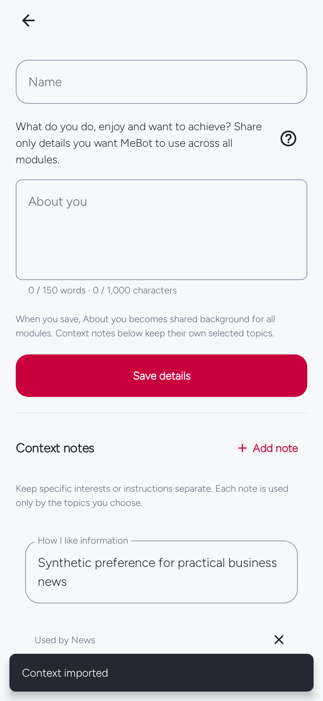

# Start here — MeBot 0.9.5

[Download Android APK](https://github.com/EmmanuelMmanda/MeBot/releases/download/v0.9.5/mebot-0.9.5.apk) · [Release files](https://github.com/EmmanuelMmanda/MeBot/releases/tag/v0.9.5) · [Full user guide](docs/USER-GUIDE.md)

## 1. Choose interests
Pick topics and, optionally, a city. The app does not require an imported context file.

## 2. Import only what you want
If you import context JSON, review the replacement first. After confirming, MeBot returns to your details with the saved notes visible. If you cancel or the file is invalid, your draft stays in place. Onboarding interests are already enough to begin.

This example uses synthetic notes, not personal account data. See the [context guide](docs/guides/personal-context.html#after-import) for the review flow.

## 3. Read, ask and refine
Stories open in MeBot first, with the publisher visible. Choose an item-grounded question, review or edit its draft before you send, and open the original source whenever you want. Local questions remain available offline. Relevant / Not relevant still tunes that module; Undo changes your choice.

## 4. Choose a connection
Open You → AI connection. Choose an eligible sign-in, an API key or your personal endpoint. Set the request allowance here. Public information stays usable without AI.

## 5. Set background behavior
Choose timing, preparation, connection/battery conditions and quiet hours. New results arrive as modules complete.

## 6. Keep MeBot current
Open You → Software Updates. Automatic checks and optional Wi-Fi downloads prepare eligible releases; Android requires installation approval. This package is `mebot.nguli.com`, separate from older development builds.

## 7. Use optional tools
Alarm, Focus and Daily Check-in are together during onboarding and remain available independently of AI. Run a short alarm test before relying on it overnight.

The in-app guide is skippable and replayable from Help. Captures use dated public content or synthetic state; [source and image notes](docs/screenshots/README.md).
