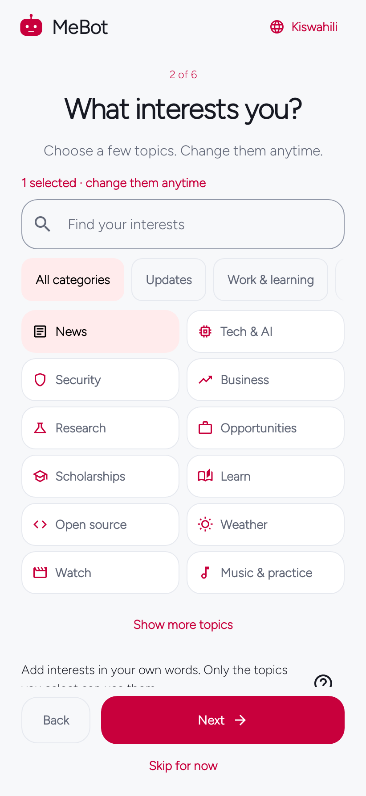
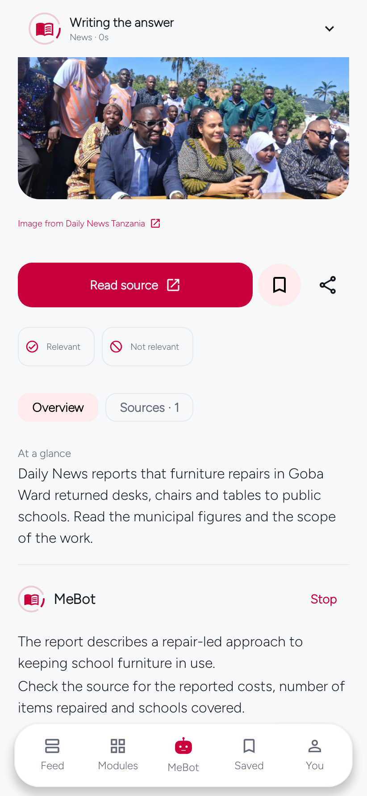
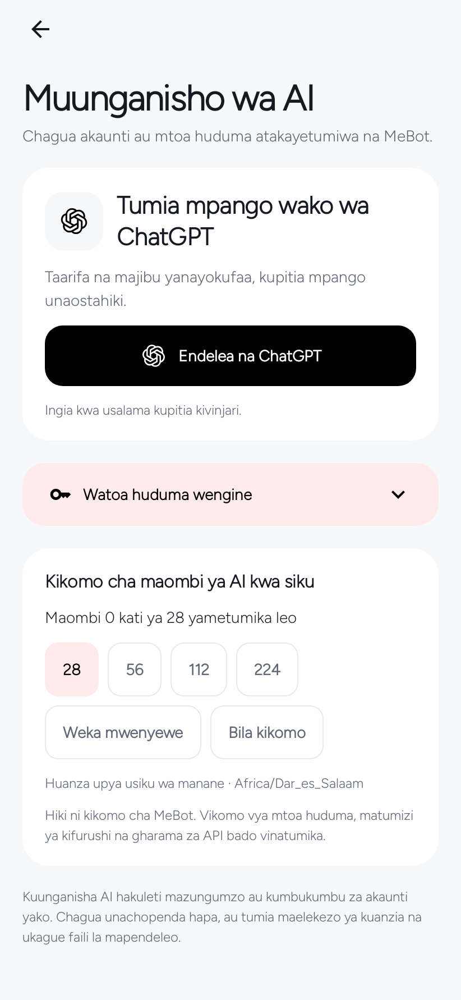
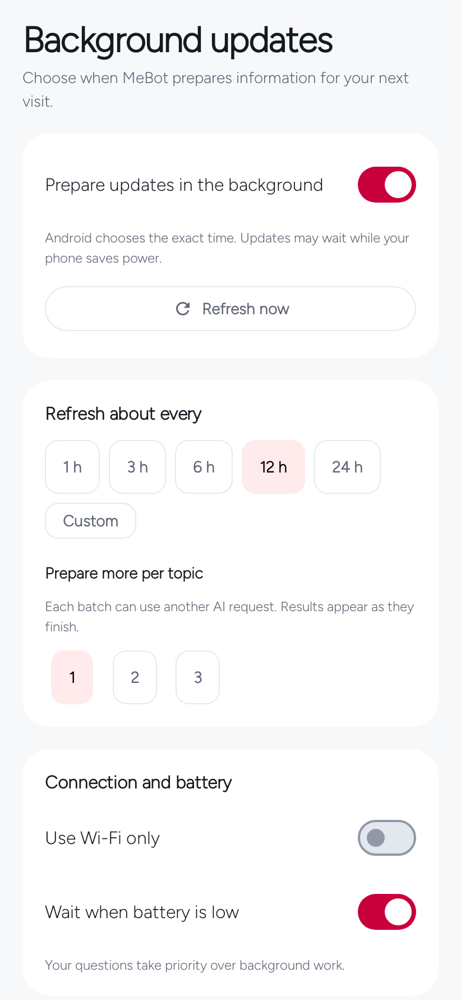
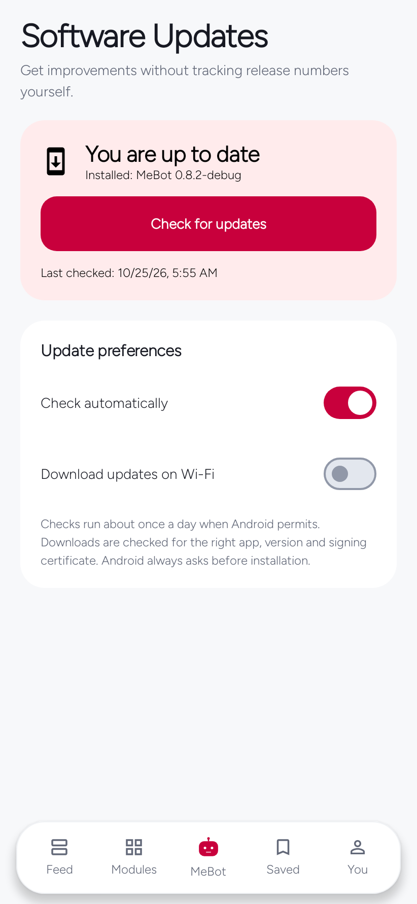
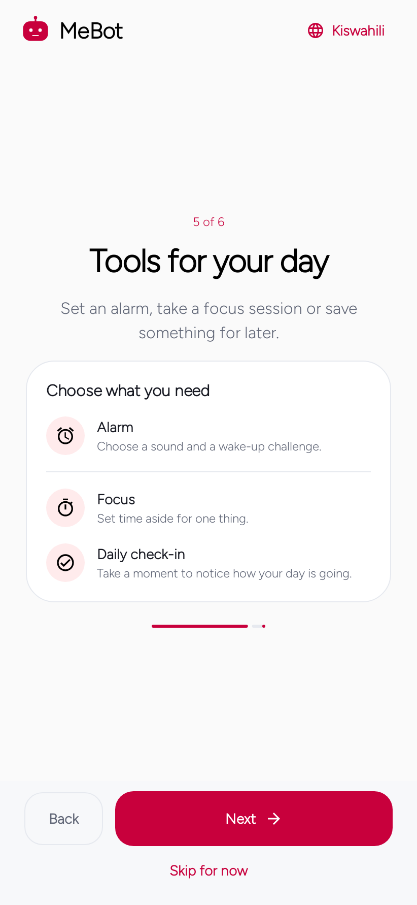

# Start here — MeBot 0.9.3

[Download Android APK](https://github.com/EmmanuelMmanda/MeBot/releases/download/v0.9.3/mebot-0.9.3.apk) · [Release files](https://github.com/EmmanuelMmanda/MeBot/releases/tag/v0.9.3) · [Full user guide](docs/USER-GUIDE.md)

## 1. Choose interests
Pick topics and, optionally, a city. The app does not require an imported context file.

## 2. Read, ask and refine
Open an item for the introduction and an automatic explanation when AI is connected. Sources remain accessible. Relevant / Not relevant tunes that module; Undo changes your choice.

## 3. Choose a connection
Open You → AI connection. Choose an eligible sign-in, an API key or your personal endpoint. Set the request allowance here. Public information stays usable without AI.

## 4. Set background behavior
Choose timing, preparation, connection/battery conditions and quiet hours. New results arrive as modules complete.

## 5. Keep MeBot current
Open You → Software Updates. Automatic checks and optional Wi-Fi downloads prepare eligible releases; Android requires installation approval. This package is `mebot.nguli.com`, separate from older development builds.

## 6. Use optional tools
Alarm, Focus and Daily Check-in are together during onboarding and remain available independently of AI. Run a short alarm test before relying on it overnight.

The in-app guide is skippable and replayable from Help. Captures use dated public content and controlled provider state; [source and image notes](docs/screenshots/v082/README.md).
