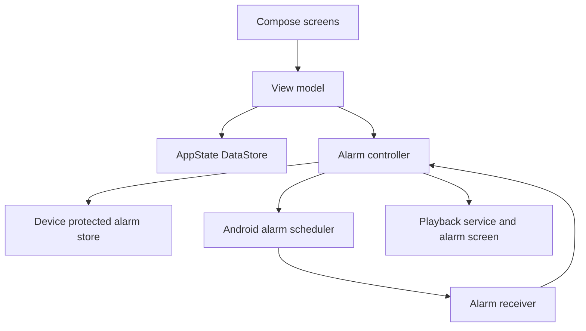

# Architecture

MeBot is a native Android application with five destinations: Feed, Modules, AI, Saved and You. The middle AI workspace contains local conversations; information modules, cached reading and personal settings remain separate concerns. Alarms, a quick daily check-in and focus are independent local tools. An owner-configured AI connection, public data adapters and optional RSS fallbacks supply the feed; local utilities and cached reading do not depend on them. The application ID, existing storage paths and operational alarm identifiers retain their original `mynguli` values for in-place updates. Visible branding is MeBot.

This document describes the implementation in the repository. Build versions, commands, and device acceptance steps are in [BUILD.md](BUILD.md). Data handling is described in [PRIVACY.md](PRIVACY.md).

## Code boundaries

| Area | Responsibility | Main source |
| --- | --- | --- |
| `core` | Serializable models, validation, daily rules, focus calculations, alarm date calculation, portable backups | [Core source](../core/src/main/kotlin/app/mynguli/core) |
| Main Compose UI | Feed onboarding, five destinations, story details/search, optional tools, preferences and history | [UI source](../app/src/main/java/app/mynguli/ui) |
| Feed domain | Modules/preferences/order, context scopes, item identity, conversation/cache validation, ranking and retention | [FeedLogic.kt](../core/src/main/kotlin/app/mynguli/core/FeedLogic.kt), [ModulePreferences.kt](../core/src/main/kotlin/app/mynguli/core/ModulePreferences.kt), [Conversations.kt](../core/src/main/kotlin/app/mynguli/core/Conversations.kt) |
| Feed runtime | Feed DataStore, credential vault, HTTPS/RSS, provider adapter, refresh coordination and delivery | [Feed source](../app/src/main/java/app/mynguli/feed) |
| ChatGPT sessions | Browser PKCE, loopback callback, verified identity, encrypted renewable accounts and model discovery | [Auth source](../app/src/main/java/app/mynguli/feed/auth) |
| Personal service | Optional authenticated Python backend, source checks, caching, budgets and scheduled preparation | [Service](../service/README.md) |
| View model | Apply user actions, publish state, coordinate persistence with platform alarms, report localized outcomes | [MyNguliViewModel.kt](../app/src/main/java/app/mynguli/MyNguliViewModel.kt) |
| Main repository | Store one immutable `AppState` through AndroidX DataStore | [AppRepository.kt](../app/src/main/java/app/mynguli/data/AppRepository.kt) |
| Alarm runtime | Exact schedules, persisted occurrences, snooze/checkpoint transitions, sound, vibration, restoration, and cancellation | [Alarm source](../app/src/main/java/app/mynguli/alarm) |

The `core` module is Kotlin/JVM and has no Android dependency. The `app` module owns the Android lifecycle and services. Alarm operation does not depend on the daily screen staying open.

DataStore and the alarm store are separate persistence boundaries. DataStore serializes changes to the personal state. The view model serializes alarm-related mutations and reconciliation; the controller also synchronizes its operational state. These boundaries do not form a transaction across both stores and the operating system. A process interruption between those steps remains a reconciliation concern, so restoration, cancellation, and failure reporting are explicit parts of the implementation.

## Information modules and AI

`FeedState` has its own schema version and AndroidX DataStore at `files/mebot/feed.json`. Existing `AppState` remains separate so a feed migration does not rewrite alarm plans, check-ins or focus history. Feed state contains modules, explicit context, items, saved/hidden identifiers, local conversations/attachments, completed explanations, reading history, connection configuration, delivery preferences and request counters. It never contains the provider key or service token.

`ModuleCatalog` provides 16 built-in modules grouped by purpose; additional custom watches are configuration with stable identifiers. Catalog metadata defines research guidance and preferred resource type. `mergeCatalog` appends new modules in a paused state, preserves existing IDs/settings/order and never exceeds the 32-module limit. Each module declares its kind, query, sources, enabled state, alert choice and a backward-compatible `preferences` map. `ModulePreferences` is the per-kind allowlist for keys, enumerated choices and bounded location text. Custom topics override starter queries while preferences augment the research guidance. The optional `media` kind discovers original/official short-video destinations; it is not a video-hosting or in-app streaming subsystem.

`ModuleOrder.reorder` accepts an exact permutation of the complete current module IDs and returns the same objects in that order. The drag UI rearranges installed rows without regrouping hidden/paused IDs, submits once on drop, and rolls back on failure. Move-up/down actions provide an accessible alternative. Home and search filter lists derive from persisted module order. Local utilities retain their independent implementation. A new executable capability requires a source change, not a remotely downloaded plugin.

The native path has these boundaries:

1. `FeedViewModel` coordinates persisted user actions, cancellable operations and visible error states. Edits remain on screen until the committed state matches the draft. Old request completions cannot clear a newer operation's loading state.
2. `FeedEngine` serializes refreshes, prioritizes connected AI discovery, serves public weather and repository data, reserves AI requests atomically and merges successful results. Public results commit in completion order; a slow fallback cannot hold back completed data. Changed context, modules or credential generations invalidate stale results; a partial failure leaves cached reading intact.
3. `RssSourceReader` parses RSS/Atom without model involvement. It rejects document type/entity declarations, bounds payloads and entry counts, removes markup and keeps the original article URL. Missing publication dates are unknown, with retrieval time shown separately.
4. `OpenAiFeedProvider` branches explicitly among ChatGPT subscription, direct API-key and personal-service transports. API-key feed generation uses strict structured output. Subscription feed generation uses the permitted streaming request shape, a schema instruction and local validation. Conversation/explanation transports expose real text deltas to transient UI state; only completed validated answers enter durable state. Both factual discovery paths require URLs in returned search metadata or citation annotations. This is a provenance check, not independent verification of every sentence. Questions have clickable citations and no action-taking tools. The optional personal service returns completed JSON.
5. `PublicDiscoveryProvider` supports Open-Meteo forecasts, GitHub public search and Hacker News fallback. These requests contain configured query/location/filter data, never private context notes or AI tokens. Cache keys snapshot the complete preference map. Weather uses a module location override with profile-region fallback; GitHub applies selected focus/language search qualifiers. Weather values come exclusively from the typed public adapter. `PublisherMediaEnricher` fetches bounded source-page metadata after text commits; `FeedMediaRepository` loads public images with downsampling and bounded memory/disk caching. Image failure never removes source content. See [discovery and media](DISCOVERY-MEDIA.md).
6. `FeedWorker` runs opt-in periodic refresh with network/battery constraints. It honors per-module alert choices, excludes horoscope alerts, retains pending items through quiet hours and posts at most one feed notification per configured local day. Android chooses actual execution time. The notification opens the relevant story, including after activity recreation.

The default request limit is 28 attempted AI calls per local day. Each enabled AI module can consume one call per refresh; a new story explanation, conversation turn, keyword search or subscription connection/model check consumes another. Search is one request across its selected modules, with additional provider tool usage possible. Failed attempts count because their provider outcome may be uncertain. This is a call limit, separate from ChatGPT allowance and API spending controls. Public adapters, optional RSS, publisher images, cached reading and a reusable completed explanation do not consume it. The least recently refreshed AI module is served first to avoid starvation at the local cap. Actionable subscription errors persist `aiPauseCode`; automatic AI stays paused while public source refresh continues. Deliberate requests may retry, without an automatic billing fallback.

On Feed activation/resume, `refreshIfStale` compares the last successful refresh with the configured interval. It preserves cached content, avoids concurrent connection/refresh work and throttles automatic failures for five minutes. A shared foreground minute clock keeps relative ages and the local date current; it pauses with the lifecycle. System language is resolved to supported English/Kiswahili before the provider is called.

Saved items survive refresh and module pauses. Other items are bounded to 250 recent entries. The feed initially reveals five visible items, diversified across enabled modules and publishers, with relevance and freshness considered; additional items are requested explicitly. Hidden IDs keep dismissed stories from reappearing. A horoscope is shown in Feed only on its retrieval date in the configured timezone; a saved reading remains accessible from Saved.

Optional reading history records at most 1,000 opened-item timestamps and temporarily reduces already-opened items' rank. It does not hide them or discard approaching deadlines. Disabling history stops both recording and its effect on ranking; clearing it retains saved items and conversations. A bounded edition sequence breaks otherwise equal ranking ties after successful refresh without changing publication timestamps. Cached pagination remains a local action.

### Story explanations, conversations and search

Opening story details calls `loadDetail`. It first checks `BriefCache` for a completed explanation less than six hours old with a matching fingerprint over source content, module settings, approved scoped context, connection, region/timezone and language. Otherwise a connected account starts a real explanation request automatically. At most 24 completed explanations are kept. Previously completed text can still be read offline; partial/cancelled streams are never promoted to a cached answer. Source summaries and citations do not guarantee full article access.

`AiConversation`, `AiTurn` and `AiAttachment` live in `FeedState`. The workspace can create, select and delete local threads; story follow-ups retain their item association. User turns are durably recorded before generation. Retrying the same unanswered question does not append a duplicate user turn. Completed answers record citations and model metadata after request/context/generation guards pass. Stored limits are 24 threads, 60 turns per thread and 800,000 aggregate text characters; a provider request uses only the last 16 turns within 36,000 characters. Workspace drafts survive recreation without storing secrets.

General workspace threads start without personal-context notes. A selected module or story supplies only confirmed entries scoped to its kind. Explicit `.txt`/`.md` attachments must decode as UTF-8, be at most 48 KiB per file and stay within three files / 24,000 combined characters per thread. Imported text is reviewable and removable and is sent only with a conversation message. Files, source pages and quoted history are treated as untrusted input, not executable instructions.

`FeedEngine.search` reserves one request, passes enabled factual modules and the submitted query to the provider, then checks module membership, URL provenance and item validity before retaining results. Weather and horoscope are excluded. Changing configuration/account during the operation invalidates its result. Search owns separate query/loading/error/cancel state and does not alter the feed refresh timestamp.

Speech features use Android services only when available. Voice input launches a speech-recognition activity and returns text to the draft without auto-send. Read-aloud uses an installed `TextToSpeech` engine with language support, stops on lifecycle exit, and does not imply offline speech or model-native audio. Video/resource actions open their original destinations.

### Personal context and credentials

Only confirmed entries scoped to the requesting module kind are sent from Android, at most 32 per module. Legacy single-question Ask uses the news scope; the new general workspace explicitly has no personal-context scope until the user selects a module or story. A new context note defaults to news, opportunities and watches. Existing entry identity and scopes survive text edits, including multiline text. Profile/context edits clear old relevance explanations and invalidate an in-flight personalized response; completed explanation caches require a matching relevant-context fingerprint before reuse. Editors allow explicit note-to-module permissions; scope changes and module configuration are committed atomically. Context and enabled-module changes mark the feed stale so the next visit uses the saved configuration.

The optional `assets/mebot-profile.json` is a private build input, imported once into ordinary editable state. The public source excludes it. `docs/context-example.json` documents the portable `mebot-context-v1` format. There is no account-memory API or complete ChatGPT-export importer in this implementation. Import is explicit and replaces the reviewed context/profile, and optional module configuration.

`SecretVault` uses Android Keystore AES-GCM and private preference storage for the encrypted credential. Connection validation precedes a short non-cancellable secret/configuration commit with rollback on storage failure. Keys are excluded from saved instance state, application state, exports and logs. Disconnect invalidates pending AI results. Reset cancels tracked document imports so a delayed document provider cannot repopulate erased state.

`ChatGptAuthManager` has an independent encrypted session store under `noBackupFilesDir`. It exposes only nonsecret account/model state. `FeedState.connection` remains the authoritative provider/account selection, committed only after a completed inference check; adding or failing a different account cannot replace it. A rendezvous channel delivers the browser launch once while the Activity is resumed. Pending sign-in survives rotation in the ViewModel but is not restored after process death.

OAuth refresh uses a per-account mutex and atomically replaces the access token, rotated refresh token, expiry and scopes. Each module obtains a current token. A short protected refresh transaction finishes storing an issued replacement even if its caller cancels; reset and credential-generation guards still prevent resurrection. Expected-token checks prevent an old unauthorized response from clearing newer credentials. Requests tied to changed context, provider or account are discarded before committing content. See [CHATGPT-CONNECTION.md](CHATGPT-CONNECTION.md) for the protocol and known integration boundaries.

Direct mode is a personal convenience: requests originate on the phone using the owner's key. The optional service keeps the provider key on a server and gives Android a separate service token. It is a single-person deployment with no public endpoint included. Its scheduler/webhook is not a preconfigured Android push channel. See [service documentation](../service/README.md) and [privacy](PRIVACY.md).

### Feed validation and backups

Feed validation bounds modules (32), sources per module (6), context entries (80), individual context text (1,000 characters), items (1,000), saved IDs (500), hidden IDs (1,000), reading timestamps (1,000), request limits and quiet hours. `ConversationLogic` separately validates the conversation/attachment/brief bounds above. Imports and storage are bounded to 8 MiB; context import is bounded to 512 KiB. Configured fetch targets must be public HTTPS URLs. The transport rejects private/local DNS results and does not forward credentials on redirects.

Feed backup is separate from local-tool backup. It contains cached items/explanations, context, module order/preferences, conversations/attachments and reading history, but no credential or local ChatGPT account identifier. The UI chooses a file first; `prepareContextImport`/`prepareFeedBackup` validate it and publish a counted preview. Only `confirmImport` applies that staged candidate. A failed decode leaves current data untouched, and a failed write retains a retryable preview. A restored feed is durably stored disconnected with background delivery off before old AI credentials/registrations are cleared; the owner reconnects explicitly. Optional version-one defaults allow older state to decode without conversations, reading history, module preferences or new detail fields. Existing saved IDs, alarms and settings retain their meaning. Full device erasure clears both repositories and the operational alarm store. Exported files are readable JSON and are not removed by reset.

`OperationDiagnostics` retains bounded operation/error/correlation metadata for local troubleshooting and logs safe exception class/code locations without provider payloads. The optional Your data panel is collapsed by default. Operational diagnostics are separate from conversation text and are not an analytics upload.

## The daily visit

The check-in derives today's date from the device's local calendar. `DailyLogic.draftForDate` returns the existing entry for that date, including a completed entry. It creates a blank draft only when the date has no entry. Local-tool defaults contain no personal name, work, location, or previous progress.

The one-screen check-in offers an optional mood and a visible suggested next action. The owner accepts a suggestion, chooses an alternative or writes their own. Notes and duration changes are optional. Suggestions use local rules and are not inferred emotions or remote AI output.

`DailyLogic.completeVisit` requires a substantive selected outcome and next action. Arrival and departure can be blank. It trims text, removes unused empty slots and preserves the first completion timestamp. Completion records an accepted plan, not achieved outcomes. Outcome checkboxes are separate actions. Existing multi-outcome visits remain readable.

A saveable screen draft preserves pending edits through rotation. The route captures the local date when opening the check-in; crossing midnight while editing does not move the record, and a later new-day visit gets a separate saved-screen key.

`DailyLogic.upsertVisit` uses the local date as the uniqueness boundary. If a recreated screen has generated a new draft identifier for an already stored date, the original stored identifier and creation time remain authoritative. A late incomplete autosave cannot replace an already completed visit. The helper also prevents an existing identifier from being moved to a different date.

Arrival and departure are stored as stable strings rather than translated display text. The current UI maps known keys to English or Kiswahili resources. History displays an unfamiliar stored value as supplied rather than inventing a different feeling. There is no sentiment inference, wellbeing score, diagnosis, or automatic claim that the visit improved the person's state.

## Configuration

Local-tool preferences are fields in `Settings`, not private constants embedded in screen code. The local subsystem starts with all four utility identifiers enabled, an empty alarm list and no active focus session. Information-module preferences belong to `FeedState` as described above.

| Setting | Current behavior |
| --- | --- |
| `language` | `en`, `sw`, or `system`. Main UI resources follow this preference; the alarm runtime receives a copy for operation before unlock. |
| `theme` | `system`, `light`, or `dark`. |
| `accent` | The UI implements `ember` (now raspberry), `sage`, and `blue`. An unfamiliar nonempty stored accent uses the default palette. |
| `enabledModules` | `daily` is required. `focus`, `alarms`, and `history` control the optional surfaces. |
| `defaultFocusMinutes` | Used when a new visit or unsuggested focus session is created. Existing plans keep their own duration. |
| `checkpointLabel` / `checkpointCode` | The current personal QR checkpoint. A configured alarm stores the checkpoint values it will require. |

Module switches control access and operation; they do not erase the module's saved records. Hiding focus retains an existing session, and hiding history retains historical records. Disabling alarms invokes `cancelAll`, which cancels scheduled, active, and queued occurrences, including tests, while retaining the main saved plans and diagnostic history. Enabling the module reconciles its saved plans again.

`saveSettings(transform)` applies a change to the latest settings inside the repository update. Callers should use that form so two quick preference changes do not overwrite each other or erase a newly created checkpoint. All user-facing copy belongs in Android resources. The UI uses named design tokens and bundled Figtree fonts rather than personal assets or remote font requests.

## Focus timing

`AppState.focus` contains at most one active interval. Starting focus checks for an existing interval inside the DataStore update. The timer stores its title, original duration, start time, deadline, and optional paused remaining time.

Pausing calculates and stores the remaining duration. Resuming sets a new deadline from that duration. Repeated pause and resume calls are idempotent. Remaining time is clamped to the range from zero to the original duration.

The Compose screen refreshes the displayed time while it is visible. There is no separate focus foreground service, completion notification, or background focus sound in this version. Closing the screen does not lose the stored deadline; reopening reconstructs the elapsed timer. After the interval reaches zero, the person explicitly saves the completed session. Cancelling an interval clears it without adding completed minutes. The view model prevents duplicate completion records with the same session identifier.

Focus uses wall-clock deadlines. Device clock changes can affect elapsed time, although a backward change cannot expand the displayed remaining time beyond the originally selected duration. A saved record represents completion of the timer, not independently verified attention or work.

## Personal state and backup schema

The main repository stores serialized JSON in the app's credential-protected `files/mynguli/state.json`, through AndroidX DataStore. It exposes a flow of immutable snapshots and serializes updates. The application initializes this repository lazily; Direct Boot alarm receivers do not need to open personal notes before the device is unlocked.

Schema version 1 contains:

| Field | Content |
| --- | --- |
| `schemaVersion` | Portable format version, currently `1`. |
| `profile` | Optional name, personal intention, and onboarding completion. |
| `settings` | Language, theme, accent, enabled modules, default duration, and checkpoint. |
| `visits` | One entry per date, arrival/departure, energy, note, outcomes, selected outcome, next action, and timestamps. |
| `focus` | The current interval, or `null`. |
| `focusHistory` | Explicitly saved completed intervals. |
| `alarms` | Alarm plans, recurrence, dismissal mode, math difficulty/count, snooze policy, checkpoint requirements, volume, ramp, vibration, selected sound and optional spoken wake-up message. |

The local DataStore serializer accepts unknown JSON fields when decoding its own stored state, then validates the decoded schema and values with `StateValidation`. A future schema or invalid state fails visibly, and an unreadable file is not silently replaced with empty data. Explicit portable import uses `BackupCodec`, which additionally rejects unknown fields and enforces its file-size boundary.

### Import and export rules

Export validates the complete current state and emits readable UTF-8 JSON. The system document picker chooses the destination. There is no backup encryption, password, signature, or cloud-sync layer in the app.

Import reads a bounded candidate, requires an explicit supported schema version, parses the complete object, and validates it before replacement. Unknown fields and unsupported versions are rejected. Optional fields can use the defaults declared in the serializable models. Import replaces the current state; it does not merge visits or resolve duplicates.

After validation, imported alarms are stored disabled and the active focus interval is cleared. The view model commits that reviewed candidate, clears previous operational alarm state, and reconciles the imported disabled plans. A malformed or unsupported candidate does not replace existing data. A failure after storage replacement has distinct UI copy and must not claim that existing data is unchanged.

The current validation limits are intentional bounds on the format:

| Item | Limit |
| --- | --- |
| UTF-8 backup | 8 MiB |
| Daily visits | 3,650, with unique dates and identifiers |
| Completed focus records | 10,000, with unique identifiers |
| Alarm plans | 32, with unique identifiers |
| Outcomes per visit | 3 |
| Name / intention | 80 / 500 characters |
| Note / outcome / next action | 8,000 / 300 / 500 characters |
| Focus interval | 1–180 minutes |
| Alarm volume | 1–100 percent |
| Checkpoint label / code | 80 / 512 characters |

Validation also checks dates, timestamps, selected-outcome references, required completed-visit fields, allowed module/language/theme values, and alarm parameter ranges. The constants are in [Validation.kt](../core/src/main/kotlin/app/mynguli/core/Validation.kt). The additive 0.2.0 fields use explicit decode defaults: older alarms keep STANDARD dismissal, while legacy required checkpoints resolve to QR. New alarms are created explicitly in MATH mode. Older portable backups are accepted; the older 0.1.0 importer rejects MeBot-only fields. There is no automatic archival or pruning. Exceeding a limit fails the operation rather than authorizing silent deletion.

## Alarm operation

`AlarmController` mirrors operational plans and sessions into device-protected SharedPreferences. That store contains alarm labels, checkpoint values, selected sound identifiers/URIs/display names and optional spoken messages as well as scheduled occurrence tokens, queued occurrences, active phase, snooze usage, follow-up deadlines, consumed one-time identifiers, audio restoration values, and diagnostic events. It deliberately does not contain profile intentions or daily notes.

The controller schedules `AlarmManager.setAlarmClock` callbacks. Calendar recurrence is calculated by the pure `nextAlarmOccurrence` function:

- Weekdays use ISO numbering: Monday is 1, Sunday is 7.
- An empty weekday set means the next one-time occurrence of the local time.
- The result is strictly after the supplied instant.
- A DST gap shifts the requested local time forward by the gap.
- A DST overlap uses the earlier offset once for that local calendar date.

Scheduled callbacks carry occurrence tokens. Continuations carry a session identifier and expected deadline. The controller checks those values against persisted state before acting, which prevents a stale callback from reviving a finished or replaced occurrence.

Math question sets, correct-answer progress, snooze counts and checkpoint progress belong to the persisted session. Math answers are checked atomically against both the current session identifier and current question identifier. Incorrect or stale answers cannot advance the challenge. Plain dismissal is rejected for Math and QR modes. See [alarm challenges](ALARM_CHALLENGES.md) for the complete contract.

Snooze counts and checkpoint progress belong to the persisted session. Recreating the alarm screen does not grant another allowance. A required checkpoint offers one 60-second reduced-volume walking window. A successful scan either ends the occurrence or waits for the configured follow-up, which requires another scan. The code is a behavioral cue, not proof of location, identity, or wakefulness. Emergency stop remains available and clears the current queued occurrences.

`AlarmRingingService` owns looping playback, audio focus, vibration, and the alarm notification. The foreground service plays the selected bundled, system or document sound, with bundled fallback when a selection cannot play. It ramps the volume and attempts to restore the prior alarm-stream volume when playback ends, preserving a manual volume change made during the alarm. Optional speech uses an installed offline voice and supplements the tone; it is requested after `max(1,500 ms, rampSeconds × 1,000 ms)` while the same occurrence is still ringing and no focus-loss pause or duck is active. The tone is reduced while the message is spoken. The Compose alarm screen displays and controls the persisted session; it does not own the audio lifetime.

`AlarmTonePlayback` starts bundled fallback before opening an external URI. The document descriptor is opened on IO with a cancellation signal; MediaPlayer operations remain on the main Looper. A four-second preparation deadline retains the fallback. Cancellation, generation checks and descriptor/player cleanup prevent late preparation from reviving an ended session. The editor's separate preview is limited to 12 seconds, uses the current alarm-stream volume without changing it or applying the saved ramp, and stops on lifecycle exit, accepted sound changes, save/test actions or an active alarm. Preview speech starts after about one second.

Version 0.6.1 adds `soundId`, `soundUri`, `soundName`, `speechEnabled` and `speechMessage` to `AlarmPlan` with explicit decode defaults. Missing fields retain the original tone and speech off for existing plans. The editor selects Pulse explicitly for a newly created plan, keeping the 80% volume and 20-second ramp defaults. Audio selection is bounded and validated with the rest of an alarm. Original bundled audio and its deterministic generator are documented in [ALARM-AUDIO.md](ALARM-AUDIO.md). The portable backup retains sound metadata and optional speech text; it does not contain selected audio bytes or transferable Android file grants.

`AlarmAudioAccess` records only READ grants newly acquired by the alarm picker in a separate device-protected ledger. Android owns the grants; the app stores URI identifiers and restoration deadlines, not audio bytes. Pruning retains references from saved plans, operational sessions/queues/schedules and live editor drafts. Stable draft tokens survive recreation, and a 24-hour recovery window protects newly selected files and interrupted drafts until later reconciliation. Unreferenced owned grants are released best-effort; unrelated pre-existing READ/WRITE grants remain untouched. Successful editor saves end their draft hold, while explicit device erasure clears draft holds before pruning.

Automatic reconciliation of a consumed one-time plan is different from explicit cancellation. A consumed plan may become disabled while its already-triggered occurrence is still ringing or queued. Routine `sync` must preserve that occurrence. Explicit user cancellation/deletion and full reset must stop the relevant active work as well as future schedules. Test occurrences are also tracked separately from ordinary saved plans.

Restoration handles boot, first-unlock boot notification, package replacement, clock/timezone changes, and exact-alarm permission changes. It re-registers callbacks rather than starting playback directly from the boot receiver. The current implementation has a 15-minute missed-occurrence recovery window and a one-hour interrupted-session recovery limit. These are recovery policies, not guarantees that every device delivers an alarm under every power or vendor setting.

## Extension and verification guidelines

Keep new pure policy in `core` with deterministic inputs. Keep permissions, camera, audio, notifications, and OS scheduling in the Android module. A new optional module needs a stable identifier, a validation rule, stored configuration, navigation behavior, and clear behavior when disabled; adding a label to the tools page alone does not implement a module.

When changing the portable schema, add a deliberate migration/version policy before accepting new versions. Add round-trip and rejection tests, including unknown fields and invalid references. Preserve saved identifiers and first completion timestamps. Do not reinterpret self-reported feelings as an automatic health or productivity score.

Maintain localized copy for both supported languages. Do not add a network permission, telemetry client, AI service, or remote account requirement incidentally as part of a UI feature. Such a change alters the product and its privacy contract.

The automated gate runs core tests, Android/Robolectric tests, lint, and APK assembly. Core tests cover recurrence/DST, validation, daily completion/upsert, and focus timing. Android tests cover repository persistence/import, alarm protocols and cancellation, and the actual Compose daily journey. Host tests and generated screenshots do not establish overnight audio, camera, lock-screen, Bluetooth, battery-management, or reboot reliability on a particular phone. Follow the physical-device acceptance sequence in [BUILD.md](BUILD.md).
