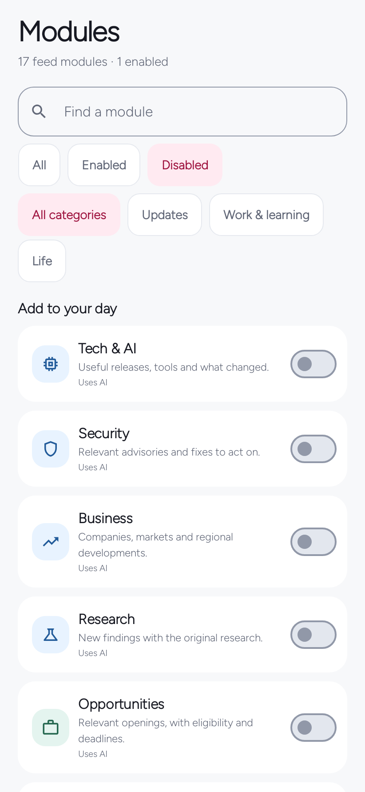

# MeBot user guide

This guide describes **MeBot 0.6.1** for Android 8.0 or later. MeBot brings a configurable feed, AI reading and conversations, and local tools into one app. You can start without an account, enable only the modules you want, and add personal context when you are ready.

The instructions use the English interface. English and Kiswahili are available under **You → Preferences → Language**. The [screenshot gallery](screenshots/README.md) shows native Android screens rendered with synthetic test data; the examples are not live news, personal accounts or claims of provider access.

**You → Preferences → Appearance** offers System, Light or Dark mode and Raspberry, Sage or Blue accents. **Default focus duration** sets the starting timer choice; 5, 10, 15, 25 and 45 minutes are offered, alongside an existing saved custom value when present.

## Contents

- [Start here](#start-here)
- [Connect AI](#connect-ai)
- [Personalize with your context](#personalize-with-your-context)
- [Choose and configure modules](#choose-and-configure-modules)
- [Read, search and ask](#read-search-and-ask)
- [Background updates and request limits](#background-updates-and-request-limits)
- [Alarms and everyday tools](#alarms-and-everyday-tools)
- [Offline use, storage and backups](#offline-use-storage-and-backups)
- [Troubleshooting](#troubleshooting)

## Start here

Install the APK from the project's release material or build it from source. An update must have the same application identity and a compatible signing certificate as the installation already on your phone. Install over that copy to preserve its data; uninstalling removes its local data. See [installation](INSTALL.md) and [building from source](DEVELOPMENT.md).

On first launch, a six-step tour introduces the feed, modules, explanations, AI workspace, local tools and personal setup. **Skip tour** is available throughout. **Open MeBot** enters the app from the final step; **Connect AI** starts connection setup. You can replay the tour at **You → Preferences → Help & FAQ → Quick tour**.

The five bottom destinations are:

| Destination | What you do there |
| --- | --- |
| **Feed** | Read a short daily selection, choose a module filter, refresh or search. |
| **Modules** | Find every available module, configure it, enable or pause it, and open local tools. |
| **AI** | Start or resume a conversation, choose its module context, and attach text. |
| **Saved** | Return to updates you bookmarked. |
| **You** | Manage personal context, AI connection, background updates, preferences and backups. |

For a useful first visit:

1. Open **Modules** and turn on two or three interests. Every built-in kind already has a **Default focus**; you do not need to write research prompts.
2. Open **You → My context** to add a few notes, or use the ChatGPT preparation flow below. Add your city/region and timezone if you want local weather and local-day timing.
3. Connect AI if you want personalized discovery, streamed explanations, search and conversations. Public sources and local tools remain usable without it.
4. Return to **Feed** and refresh. Open an update to read more, save it, or ask a follow-up.

Only News is enabled by default in a fresh public feed profile. Catalog additions arrive paused on an existing installation and preserve your choices. The local tools are configured separately.

## Connect AI

Open **You → AI connection**. Choose one of the following explicit routes.

| Route | Credential | Where inference runs | Usage rules |
| --- | --- | --- | --- |
| **Continue with ChatGPT** | Official browser sign-in and consent | OpenAI's public subscription integration | Eligible account/plan and workspace permissions; provider usage limits apply. |
| **OpenAI** | Your OpenAI API key | OpenAI's API | Separate API billing and API limits. A ChatGPT subscription is not an API credit balance. |
| **My service** | Your private MeBot service token | Your separately deployed service, then its configured provider | Your service's cap and provider billing apply in addition to MeBot's local cap. |

MeBot does not switch to API billing when a subscription request fails. Credentials are not included in its JSON exports. None of these routes imports ChatGPT conversations, saved memory or private connectors.

OpenAI's [Sign in with ChatGPT quickstart](https://developers.openai.com/siwc/quickstart) documents eligible Plus/Pro plan use in participating local/open-source applications, with separate permission for inference. This is not a guarantee that every account, workspace, model or distribution is eligible. The integration and limits described here were checked against the official documentation on 2026-10-23; provider availability can change.

### Use your ChatGPT plan

1. Tap **Continue with ChatGPT**.
2. Complete official sign-in and consent in your system browser. Allow the plan access requested by the integration if you want to use it.
3. Return to MeBot using **Open MeBot**, or switch back through Android's recent apps if your browser does not reopen it.
4. Wait for account verification, model discovery and a small model request. A saved account by itself is not proof that a model request succeeded.
5. Once connected, the screen shows the selected model and **Using ChatGPT plan**. Tap **Refresh my feed** after a connection change, or **Explore your feed** when returning to the existing connection.

MeBot lists models returned for that account instead of assuming that every account has a particular model. Choosing another model performs a check before changing the active connection. **Accounts** contains account switching, adding another account and **Sign out**. The model shown in the primary account card is the one used for its check.

If your account is saved but model access failed, use **Check connection** in its main card. You usually do not need to remove the account first. Choose another returned model when the error indicates missing capability or access. **Connection details** can show a safe stage, HTTP status, request identifier and bounded response description for troubleshooting.

**Manage usage** opens [ChatGPT usage settings](https://chatgpt.com/settings/usage). Eligibility, available models, web-search access, quotas and workspace policy are controlled by OpenAI; MeBot cannot grant them. An account that can sign in may still lack a required model capability. The documented local/open-source integration has its own availability and distribution terms. Check the current [official integration documentation](https://developers.openai.com/siwc/token-sharing-open-source/models-and-inference) and [limitations](https://developers.openai.com/siwc/token-sharing-open-source/preview-limitations) rather than assuming any plan guarantees access.

This subscription route does not provide image-generation, audio, video or Files APIs, hosted MCP tools or private connectors. Web search is conditional on account/model support. MeBot's reviewed text attachments and Android voice input/read-aloud are separate app/phone features; they do not imply access to those unavailable APIs.

Closing or cancelling an attempt leaves the previous working connection selected. If Android kills the app during browser consent, start a fresh sign-in. Sign-out removes local account tokens and attempts provider revocation; an unconfirmed remote revocation is reported so you can also manage the grant in ChatGPT settings.

### Use your own API key

1. Open **Use an API key instead**.
2. Enter your own OpenAI API key. Never use someone else's key or a key supplied in a public source download.
3. Open **Advanced settings** if you need to change **Model**. Keep **Connection → OpenAI** for direct API access.
4. Tap **Check and connect**. This performs a small real inference request; it is not just a key-format check and may incur API usage.

The shipped direct-mode model field defaults to `gpt-6-luna`. That is an editable application default, not a promise of access for your project. Choose a model your API account can use and that supports the capabilities you need, including web search for factual discovery. API model IDs and subscription model IDs must not be assumed interchangeable. See the [provider's model documentation](https://developers.openai.com/api/docs/models).

Use **Replace key** to change a connected API credential, and **Disconnect** to remove it. An unsuccessful replacement does not commit the new credential over the working connection. A secret typed into an unfinished form is intentionally not restored after rotation or process recreation.

### Connect a personal service

This is an optional deployment for someone who wants the provider key on their own server. The APK does not include a hosted service.

Under **Use an API key instead → Advanced settings**, choose **My service**, enter its public **HTTPS service URL** and matching model, then enter the **Service token** and select **Check and connect**. The service token is different from the provider API key. The model entered in the app must match the server's configured model; the server rejects a mismatch.

This build requires a public HTTPS hostname, normally on port 443. Localhost, private/LAN addresses and custom ports are not supported for the Android service connection. The service is single-person software, with one private token for a deployment. Setup and endpoint details are in the [service guide](../service/README.md). Subscription OAuth tokens are never sent through that service.

## Personalize with your context

Open **You → My context**. Import, paste, preparation prompt, editable notes, region, timezone and export are on this page. There is no Advanced settings step for context.

You can type notes directly: add one useful interest, preference or goal at a time, choose **Choose modules** beneath a note, and finish with **Save context**. The **Used by** label shows the permitted kinds. New manual notes initially target News, Opportunities and Watchlists; change that selection to match the note. Up to 80 notes of 1,000 characters each are supported.

Only confirmed notes relevant to a request's module are sent to AI. A general AI conversation starts without saved personal notes. Notes approved for the custom `watch` kind are shared with all custom Watchlists; they are not private to one named watch. Weather uses your configured place without requesting GPS access. Module preferences narrow discovery but do not grant access to extra notes.

### Prepare a context file in ChatGPT

1. Tap **Prepare in ChatGPT**. MeBot copies a generic compatible prompt and opens `chatgpt.com`. It does not put your existing MeBot notes into the clipboard or submit the prompt automatically.
2. Paste and send the prompt in a ChatGPT conversation that has useful information about you. Any available ChatGPT memory depends on that conversation/account's settings.
3. Read the returned JSON. Remove anything wrong, outdated, too private or unnecessary. A model's confidence is not evidence that a personal fact is correct.
4. Return to MeBot and choose **Import file**, or **Paste JSON → Review import**.
5. Check the entry/module counts and replacement description, then confirm the import. Cancel leaves the current data unchanged. Review individual notes and their permissions on My context afterward.

This is a user-controlled transfer. Account sign-in and an API key do not give MeBot an automatic memory/history API. An entire ChatGPT export ZIP is not a MeBot context file. The provider's sign-in boundary is documented in the [connection contract](CHATGPT-CONNECTION.md).

The in-app **Copy prompt** and **View prompt** actions are available even without an AI connection. This equivalent prompt can also be copied directly:

```text
Create mebot-context.json for MeBot using only facts and preferences you reliably know about me from this chat or available saved memory. Do not guess, include secrets, or expose other people's private details. Prefer current information; leave unknown profile fields empty. Return a downloadable JSON file or raw JSON without Markdown. Use this schema:
{"format":"mebot-context-v1","name":"","region":"","timezone":"","entries":[{"id":"preference-1","text":"Replace with one reliable preference about me.","category":"preference","scopes":["news"],"confirmed":true,"origin":"imported","updatedAtMillis":0}],"modules":[]}
Replace the example entry. Use unique ids, concise text (maximum 1000 characters per entry), category interest/preference/goal, confirmed:true, and only relevant scopes from: business, entertainment, events, github, horoscope, learning, media, music, news, opportunities, scholarships, science, security, technology, travel, watch, weather. Keep modules:[] to preserve my module choices. If nothing reliable is available, leave entries empty. I will review the file before importing it.
```

**Context import replaces your profile fields and notes; it does not merge them.** A nonempty `modules` array also replaces feed-module settings. Keep `modules: []` to retain the existing modules and order. Context-only import preserves the current AI connection, saved reading and local tools. Export the existing context first if you want a recoverable copy. The [empty example](context-example.json) is a valid starting format; a blank timezone uses the device timezone, while a specified value must be a valid IANA zone such as `Etc/UTC`.

Context files are limited to 512 KiB; the paste editor accepts up to 131,072 characters. Raw JSON is preferred; one enclosing unlabelled or `json` Markdown code fence is also accepted. Invalid or oversized input does not replace your data.

## Choose and configure modules

**Modules** shows the whole catalog. Use **Find a module**, **All / Enabled / Disabled**, and **All categories / Updates / Work & learning / Life** together. **All modules** on Feed opens the complete catalog; **Add to your day** opens the disabled selection. Clearing the filters restores the full list.

Tap a module to open **Module settings**. Read its **Default focus**, optionally narrow its topic, set preferences and select approved notes under **Personalization**. **Use default focus** clears the custom focus. **Reset these preferences** clears only the preference overrides. Save the edit to apply it. A built-in module works with its default focus without assuming personal facts that you have not provided.

Hold a handle under **Your modules** and drag to change the home-filter order. Accessible **Move up** and **Move down** actions provide the same control. Filtering the catalog does not itself reorder anything, and moving the visible selection preserves the other modules' positions.



### Every feed kind

The first choice in each preference list below is the default. All kinds except Weather also offer **Content language: App language / English / Kiswahili**. A module's explicit language and location override the general profile setting for that module. Leave a location empty to use the profile region.

| App name · schema kind | Default purpose | Preferences |
| --- | --- | --- |
| **News** · `news` | Recent developments, what changed and the practical consequence. | Coverage: Balanced / Local / World; city or region. |
| **Tech & AI** · `technology` | Useful capabilities, releases and original documentation. | Focus: All / AI / Software / Infrastructure / Hardware. |
| **Security** · `security` | Vendor advisories, verified affected versions and documented fixes. | Focus: All / Software / Cloud / Networks; urgency: All / Critical first. |
| **Business** · `business` | Business and policy developments with practical implications and dated figures. | Focus: All / Regional / Operations / Markets; city or region. |
| **Research** · `science` | Original research, evidence and a material limitation. | Focus: All / AI / Health / Climate / Space. |
| **Opportunities** · `opportunities` | Active openings, contracts and grants with official application links. | Type: All / Jobs / Contracts / Grants; work location: Any / Local / Remote; city or region. |
| **Scholarships** · `scholarships` | Funding, eligibility, intake and application dates. | Level: Any / Masters / PhD; funding: Any / Fully funded. |
| **Learn** · `learning` | A practical lesson or guide with prerequisites and a starting resource. | Level: Any / Beginner / Intermediate / Advanced; format: Any / Guides / Courses / Videos; cost: Any / Free access. |
| **Open source** · `github` | Maintained repositories and releases with a concrete use. | Focus: All / Tools / Libraries / Self-hosted; code language: Any / Python / JavaScript / PHP / Go / Rust. |
| **Weather** · `weather` | Current conditions and near-term forecast for a configured place. | City or region. No GPS permission. |
| **Watch** · `entertainment` | Spoiler-free films/series and official trailers suited to approved taste. | Type: Films and series / Films / Series; mood: Any / Tense / Thoughtful / Light. |
| **Music & practice** · `music` | Listening discoveries, performances and instrument lessons. | Focus: A mix / Listening / Practice; format: Any / Performances / Lessons. |
| **Clips** · `media` | Useful explainers, demonstrations and interviews from original/official channels. | Focus: All / Explainers / Demonstrations / Interviews / News; length: Up to 10 min / Up to 3 min / Any. |
| **Events** · `events` | Upcoming events with date, timezone and organizer registration links. | Attendance: Any / Nearby / Online; when: Next 30 days / Next 7 days; city or region. |
| **Places** · `travel` | Specific places and practical visitor information. | Focus: All / Weekend trips / Outdoors / Culture; cost: Any / Lower cost; city or region. |
| **Horoscope** · `horoscope` | A short optional entertainment reading. | Zodiac sign; focus: General / Work / Relationships / Reflection; tone: Calm / Playful. |
| **Watchlist** · `watch` | Current updates for a custom topic. Create one with **Follow a topic**. | Name and topic; format: Any / Articles / Videos. |

Horoscope needs a sign before **Show in feed** can be enabled. It is entertainment, has no scientific prediction guarantee, and is excluded from factual search and feed alerts. Weather needs a recognizable city/region. Both keep their dedicated flows.

The catalog contains 16 built-in kinds plus custom Watchlists, with up to 32 saved feed modules in total. **Watch** for films and series is distinct from **Watchlist** for a topic. Removing a custom watch stops its updates but keeps saved stories.

### Sources and alerts

Connected AI can research current web sources using the selected module's purpose, preferences and approved notes. The public adapters for News, Weather and Open source use Hacker News, Open-Meteo and GitHub respectively. Public discovery is not a connection to a private GitHub account or private calendar.

RSS is optional. A module's advanced source editor accepts up to six public HTTPS RSS URLs. Most other catalog kinds need connected AI unless you supply a usable public feed. A source or provider failure preserves the useful cached content rather than clearing your feed.

Factual AI results require source URLs supported by provider search/citation metadata. Images come from publisher metadata; AI does not invent image URLs. This provenance check does not independently prove every generated sentence. Media links open authorized source/watch pages; MeBot does not download or redistribute videos or bypass a publisher's access rules. See [discovery and media](DISCOVERY-MEDIA.md).

Turn on **Include in update alerts** for modules you want in a daily digest, then enable background updates. Per-module alerts alone do not enable background delivery.

## Read, search and ask

### Feed and saved reading

Feed starts with five selected updates, balancing freshness, relevance, modules and publishers. **Show more** reveals more cached items; it does not spend another AI request. Module filters and saved ordering help you browse a particular interest. Tapping the already selected **Feed** bottom tab returns to the top and requests a refresh; repeated taps during an active refresh share that work.

Use the bookmark to keep an update under **Saved**. **Hide this update** removes it from normal presentation. **You → Data and backups → Restore hidden updates** makes hidden updates eligible again. Pausing a module does not delete its saved reading.

Personalization comes from your chosen topics/preferences and confirmed notes. Optional local reading history also reduces the repetition of recently opened items; it does not remove them or discard approaching deadlines. Control or clear it under **You → Data and backups**. There is no advertising profile or uploaded reading-history analytics.

### Story details

Opening an update shows its overview, publisher/source links and dates. When supported by the item, it also shows **Key points**, **Useful next step** and **What to check**, plus related updates and direct actions such as an application, repository, course, event or video link.

With AI connected, **A closer look** automatically starts an explanation. Direct OpenAI and ChatGPT connections stream the answer. The optional personal service currently returns a completed answer rather than a live stream. Ask a follow-up below the explanation, use an action relevant to the kind, or open the AI workspace for a continuing discussion. Examples include **Check eligibility**, **Find the fix**, **Help me start**, **Compare options** and **Check the details**.

Completed explanations are reusable for six hours when their source, personal context, module settings, language and connection still match. Reusing that result uses no new AI attempt. Partial or cancelled output is not recorded as a completed explanation. The last completed text can remain available offline.

An explanation uses accessible source information and the provider's capabilities. It is not a guarantee that the entire article was available, that a paywall was bypassed or that every claim is correct. Original links remain available for checking consequential details such as deadlines, security fixes and eligibility.

### Search your modules

Open Search from Feed, enter a keyword or question, and choose **All modules** or one enabled factual module. Submit once to research the selected set. A search consumes one AI attempt across that selection and can return up to eight sourced results. Results can be opened, explained and saved like feed items.

Weather and Horoscope do not participate in factual search. If no factual modules are enabled, enable one first. Search needs a connected AI route and does not replace your daily feed or reset its refresh time. Cancelling a request preserves existing saved content.

### AI workspace, files and phone speech

The **AI** tab supports saved threads, source-linked answers and module-specific starting points. A general conversation receives its messages and explicitly attached text, without your saved context notes. Selecting a module or starting from a story grants only that module kind's confirmed context. MeBot sends a bounded recent conversation window; an old message being visible locally does not mean every request resends the entire thread.

Attach up to three UTF-8 `.txt` or `.md` files, at most 48 KiB per file and 24,000 combined text characters. Review and remove attachments before sending; the attachment is sent with a conversation request. Arbitrary PDFs, images and audio files are not conversation attachments in this release.

When compatible phone services are available, voice input fills the editable draft without sending automatically, and read-aloud speaks an answer. Those use Android's selected speech services, not a model-native audio connection. Their network behavior depends on the phone service. MeBot does not retain an audio recording. Alarm speech has a stricter offline-voice requirement described below.

## Background updates and request limits

Open **You → Background updates**. You can set the AI request limit even if background delivery is off.

| Setting | Available control |
| --- | --- |
| **Daily AI request limit** | 28 (new-profile default), 56, 112, 224, a custom positive whole number, or **Unlimited**. Existing chosen limits survive updates. |
| **Refresh about every** | 1, 3, 6, 12 or 24 hours; Custom accepts a whole number from 1 to 24. |
| **Quiet hours** | Start/end hours from 0 to 23. Equal hours disable the quiet period. |
| **Allow background updates** | Enables approximate scheduled refresh and digest notifications, subject to Android permissions and scheduling. |

Select **Save** to persist changes. The usage counter resets at midnight in the configured timezone, using the device timezone if none is set.

An AI attempt is reserved before a provider call. Feed generation can use one per enabled AI module. An explanation, conversation turn, search or inference connection/model check uses another. Failed or cancelled attempts remain counted because the upstream outcome may be uncertain. Public sources, cached pagination, local utilities and reusing a current completed explanation do not spend AI attempts.

**Unlimited removes only MeBot's local cap.** It does not remove ChatGPT allowances, workspace restrictions, rate limits, API charges or an independent personal-service limit. The service has a separate UTC-day attempted-call cap; its default is 48. Neither cap is a monetary spending guarantee. Review your provider's own usage and spending controls.

Background work is approximate and requires connectivity; Android may defer it. Quiet hours suppress notifications, not all retrieval or AI usage. Pending eligible updates can be delivered later, with at most one feed digest per configured local day. There is no Wi-Fi-only control in this release. Turning background updates off cancels that periodic work; the feed can still refresh when opened or explicitly requested. Alarm timing uses a separate local scheduler.

## Alarms and everyday tools

Open **Modules → Everyday tools** for **Alarms**, **Focus**, **Daily check-in** and **History**. Optional tool toggles affect availability; they do not delete the saved records.

### Configure an alarm

1. Open **Alarms** and add or edit a plan.
2. Choose its time, label and repeating weekdays. No selected weekdays means the next occurrence only.
3. Under **Turn off with**, choose **A tap** (tap Dismiss), **Math** (complete the questions), or **QR scan** (scan the configured checkpoint).
4. Open **Sound & snooze** to set sound, saved volume, gradual ramp, vibration and snooze rules.
5. Save, complete the phone-access setup, and run a short test with the screen locked before relying on the plan.

New alarms start with three easy math questions and Pulse; existing plans preserve their previous dismissal and sound settings. Math offers Easy / Medium / Hard and one to five questions, generated locally without AI. Progress belongs to that alarm occurrence and survives snoozing or screen recreation.

QR mode uses a generated checkpoint. **Create code**, give it a place label, and **Save QR image** to print or place away from bed. A follow-up scan can be disabled or set to 1, 3 or 5 minutes. Scanning is local and requires the optional camera permission. The checkpoint is a waking aid; it is not location verification or an access-control mechanism.

**Snoozes allowed** supports 0–3. With snooze enabled, choose 1, 3, 5 or 10 minutes per snooze. Saved alarm volume ranges from 10% to 100%; **Gradual volume** offers 0, 10, 20 or 30 seconds. Emergency stop remains available on the ringing screen with confirmation, including when a challenge cannot be completed.

### Sound and spoken messages

Choose **Pulse**, **Rising chime**, **Steady bell** or **Classic**; **Phone alarm sounds** opens the system picker and **Choose audio file** opens Android's document picker. MeBot keeps access to the selected file, not a copy of its audio bytes. Prefer a file available locally when an alarm must work without a network or before first unlock after a restart.

**Preview sound** plays for up to 12 seconds at the phone's current alarm volume. It does not change that volume or demonstrate the saved volume ramp. It stops when you leave the editor or another alarm takes over. A real alarm uses its saved volume and ramp. Missing/deleted/unreadable selected audio falls back to bundled Pulse; an old saved plan with no new sound selection keeps Classic.

Enable **Spoken wake-up message** to use an installed offline voice. Leave the message empty for the localized default, or enter your own. Scheduled speech starts after the ramp, with a minimum delay of 1.5 seconds; preview demonstrates it after about one second. If no suitable offline voice is installed, the tone continues. This feature does not call the connected AI provider. See [alarm audio](ALARM-AUDIO.md).

### Phone setup and reliability

The setup screen links to **Exact timing**, **Notifications**, **Lock screen** (full-screen access), and Android background battery settings. Allow alarms in Do Not Disturb and keep MeBot out of manufacturer deep-sleep restrictions. The phone must be on. Force-stop can prevent alarms until the app is reopened; this differs from closing its visible interface.

Test the sound route you actually use, including Bluetooth/headphones, and check behavior after reboot before first unlock. Restored custom audio may need to be selected again. Automated tests cover scheduling and state transitions, but do not prove overnight reliability on your particular phone. Follow the [device acceptance checks](BUILD.md#device-acceptance-before-relying-on-alarms) and keep an established alarm during initial qualification.

Focus supports timed sessions, pause/resume and completion. Daily check-in records your own description and next useful step; it does not diagnose or score your mental health. History returns to saved plans and sessions. These tools work without AI and remain separate from feed personalization.

## Offline use, storage and backups

Cached feed text, saved stories, completed explanations, conversations and local tools remain readable without a network. New AI answers, live search, fresh forecasts and uncached publisher pages/images require connectivity. A failed refresh leaves available old content in place; check retrieval dates before treating it as current.

Storage is bounded: normal refresh keeps saved items plus up to 250 recent unsaved items, with up to 500 saved IDs. Reading history keeps up to 1,000 opened-item timestamps. Completed explanation cache retains at most 24 entries. Conversations support up to 24 threads, 60 turns each and 800,000 combined text characters across turns and attachments. These bounds keep the local store manageable; the app is not an unlimited document archive. Delete old threads or export what you need.

### Three different export/restore paths

| Path | Contents and import behavior |
| --- | --- |
| **You → My context → Export context / Import file / Paste JSON** | Profile and context notes, optionally module settings. Import replaces those fields; `modules: []` keeps existing module choices. Connection, saved reading and local tools remain. |
| **You → Data and backups → Export feed backup / Import feed backup** | Feed profile, context, modules/order/preferences, cached/saved content, completed explanations, conversations/attachments and reading history. Restore replaces this feed state, removes local AI credentials after durable replacement, and leaves background delivery off. Reconnect AI afterward. Local tools remain separate. |
| **You → Preferences → Export a backup / Import a backup** | Local-tool profile/settings, check-ins, focus history and alarm plans. Import replaces local-tool data, disables imported alarms and clears an active focus interval. Review alarms before enabling them. |

**Local tools and data** under Data and backups also leads to the local-tool settings. Full backup formats are limited to 8 MiB each and use schema version 1. Choose the matching import path; the formats are not interchangeable. Context/feed imports show a validation and replacement review before you confirm. Local-tool import shows a replacement confirmation before selecting the file and validates it before replacement.

Exports are readable JSON, not encrypted vaults. Keys and OAuth tokens are excluded, but personal notes, conversations, attachments and alarm checkpoint values can be sensitive. Alarm audio bytes and Android file grants are not exported; reselect a custom file after moving a plan to another device. Keep exports in a destination you control. A cloud document provider can upload the file according to that provider's settings.

Android automatic application backup and device transfer are disabled. There is no built-in cloud sync or remote recovery service. **Erase data on this device** under Preferences requires confirmation and clears local repositories, credentials, accounts, scheduled work and alarms. It does not delete existing exports, source audio files, provider-side records or a separately hosted service database. See [privacy](PRIVACY.md) for data destinations and retention.

## Troubleshooting

| What you see | What to check |
| --- | --- |
| Account is saved, but no working model | Use **Check connection**, then choose another model actually listed for that account. Review **Connection details**. Identity success and inference success are separate. |
| Browser finishes but the app does not reopen | Use **Open MeBot** or Android recent apps. If the process was killed or the attempt expired, start fresh. Do not paste callback URLs or codes into an issue. |
| A plan/capability/workspace limit | Open **Manage usage** and review the provider's account controls. Automatic AI can pause while public sources continue. A deliberate retry is allowed, but changing the local cap cannot bypass provider limits. |
| API key connects poorly or a model is rejected | Check the selected route, project access, model ID and provider billing. **My service** needs its service token and its configured model, not an API key in the token field. |
| Feed is sparse | Enable the intended modules, check their focus/preferences and connection status, then refresh. Most modules need AI or configured feeds. Weather needs a place; Horoscope needs a sign. |
| Recommendations do not fit | Edit confirmed notes and module permissions under **My context**, then the module's topic/preferences. Generic defaults do not infer your qualifications, subscriptions or precise location. |
| An explanation stops mid-answer | Keep the existing story, check the connection/limit and retry. Partial text is not a completed cached answer. The original source remains available. |
| Search is disabled or empty | Connect AI, enable a factual module, enter a query and submit. Weather/Horoscope are excluded. No supported matching sources is a valid empty result. |
| No digest arrives at an exact time | Background work is approximate. Check notification permission, **Allow background updates**, per-module alerts, quiet hours, new items and the one-digest-per-day rule. |
| A context import is rejected | Use `mebot-context-v1` JSON, the proper field types, unique note IDs, valid scopes and timezone, and the correct size bound. Do not import a ChatGPT ZIP or a feed backup as context. |
| An alarm is silent or lacks speech | Check permissions, saved/phone alarm volume, DND and output route. Test Pulse. Verify local file availability and an installed offline voice in the chosen language. |
| Save/import/storage reports an error | Keep the current data, retry after checking device space, and inspect **You → Data and backups → Troubleshooting** if available. Do not erase data as the first recovery step. |
| An APK update will not install | Confirm Android version, package identity and signing certificate. A debug build and a release build use different package IDs; a different release signing key cannot update the existing installation. |

For an ordinary reproducible bug, include the app version, Android version, device model, selected connection route, safe error stage/code and steps using synthetic data. Never post an API key, OAuth callback, personal export or raw private provider response. Security-sensitive reports follow [SECURITY.md](../SECURITY.md).

### Implementation references

The module/default/preference contracts are in [FeedModels.kt](../core/src/main/kotlin/app/mynguli/core/FeedModels.kt), [ModuleDefaults.kt](../core/src/main/kotlin/app/mynguli/core/ModuleDefaults.kt) and [ModulePreferences.kt](../core/src/main/kotlin/app/mynguli/core/ModulePreferences.kt). Request limits are defined by [RequestBudget.kt](../core/src/main/kotlin/app/mynguli/core/RequestBudget.kt). Storage and conversation bounds are described in [architecture](ARCHITECTURE.md) and [the feed contract](FEED-CONTRACT.md). See the [verification record](VERIFICATION.md) for tested behavior and remaining physical-device/live-provider checks.


## Activity and refresh in 0.8.1

See [the illustrated activity and discovery guide](ACTIVITY-AND-DISCOVERY.md) for the fixed top panel, selected-module pull-to-refresh, local defaults and verified downloads.

## MeBot 0.8.1 guide

[Activity, scoped refresh and verified files](https://emmanuelmmanda.github.io/MeBot/guides/activity.html) — illustrated steps for the current release.
